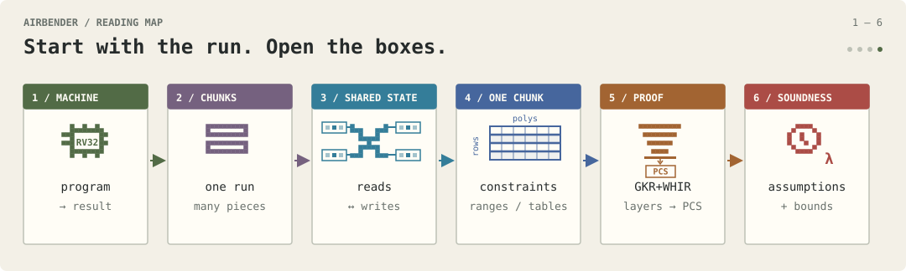
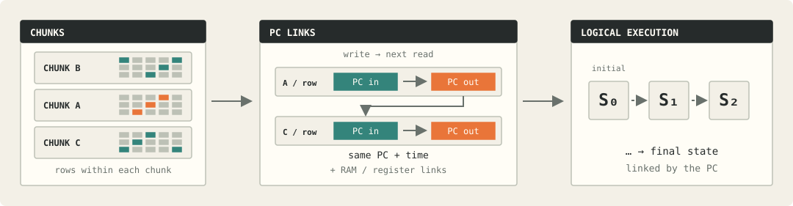
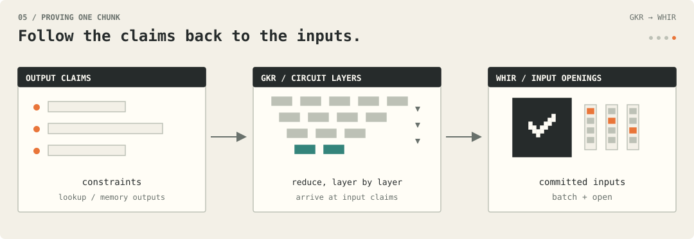

# Airbender v3 proof system

## 1. The Airbender Machine

### What Airbender proves

- **AirBender** is a cryptographic proof system capable of proving the execution of any program compatible with its supported RISC-V RV32IM subset, selected Zicsr CSRRW-based machine-interface operations (external nondeterminism-oracle access and the internal precompile-delegation bus), the Zbb REV8 instruction, and Airbender-defined Zimop operations, up to nearly 2^36 cycles of runtime (2 cycles are reserved for machine operations).

- **Program Execution** is the timed sequential execution of RISCV operations (cycles) found in the program binary. At any point in time, RISCV instructions are loaded from the binary address stored in the program counter (PC) and then executed.

- **Program binaries** must be pre-processed during the offline phase of AirBender, before any proving takes place, allowing us to setup our decoding tables. Afterwards, a bytecode simulator executes the program to generate witness data pertaining to all "machine state" memory accesses, which are committed to setup our cross-chunk "global memory argument". From just the memory traces which we are able to generate all the witness data that will be used by the prover and circuits.

- **Execution cycles** are represented as unordered entries in the witness traces,  grouped according to the portion of the ISA they belong to, and split into multiple 2²⁰-to-2²⁴ sized chunks. An "execute" flag present in the witness data determines whether the cycle is part of the execution or just padding for the chunk. There are also witness traces ("virtual cycles") not directly related to the ISA: they are used for initialisation and finalisation of the global memory argument, or fulfillment of precompile execution requests made by actual RISCV cycles.

- **Chunks** are converted by the prover into standalone proofs by applying their respective circuit constraints (frontend) to an implementation of GKR and WHIR (backend) targeting 100-bits of security. Each chunk proof outputs a local memory argument fingerprint, which can be collected by the verifier to construct the global memory argument fingerprint, and machine state, across all chunks.

- **Order** of execution is not relevant to the prover, as both the chunks and the witness traces contained therein are processed in arbitrary order. Sound progression of program execution can be inferred from the semantics enforced by the setup decoder, global memory argument, and the circuit constraints. The consistency of this "timed progression argument" will be explained later.

### Instructions and profiles

- The **Instruction Set Architecture** of the machine is a subset of RISC-V RV32IM+Zbb+Zicsr+Zimop, with the deviations and Airbender-defined operations listed below. The various instructions are collected into instruction families, each represented by a circuit or "circuit family". Support for signed M-extension operations has been removed for performance and development purposes, but can be added back if needed.

  | Instruction | Definition or distinction† |
  |---|---|
  | LUI rd, imm20 | RISC-V |
  | AUIPC rd, imm20 | RISC-V |
  | JAL rd, offset | RISC-V |
  | JALR rd, rs1, imm12 | RISC-V |
  | BEQ rs1, rs2, offset | RISC-V |
  | BNE rs1, rs2, offset | RISC-V |
  | BLT rs1, rs2, offset | RISC-V |
  | BGE rs1, rs2, offset | RISC-V |
  | BLTU rs1, rs2, offset | RISC-V |
  | BGEU rs1, rs2, offset | RISC-V |
  | ADD rd, rs1, rs2 | RISC-V |
  | SUB rd, rs1, rs2 | RISC-V |
  | SLT rd, rs1, rs2 | RISC-V |
  | SLTU rd, rs1, rs2 | RISC-V |
  | XOR rd, rs1, rs2 | RISC-V |
  | OR rd, rs1, rs2 | RISC-V |
  | AND rd, rs1, rs2 | RISC-V |
  | ADDI rd, rs1, imm12 | RISC-V |
  | SLTI rd, rs1, imm12 | RISC-V |
  | SLTIU rd, rs1, imm12 | RISC-V |
  | XORI rd, rs1, imm12 | RISC-V |
  | ORI rd, rs1, imm12 | RISC-V |
  | ANDI rd, rs1, imm12 | RISC-V |
  | SLL rd, rs1, rs2 | RISC-V |
  | SRL rd, rs1, rs2 | RISC-V |
  | SRA rd, rs1, rs2 | RISC-V |
  | SLLI rd, rs1, shamt | RISC-V |
  | SRLI rd, rs1, shamt | RISC-V |
  | SRAI rd, rs1, shamt | RISC-V |
  | REV8 rd, rs1 | RISC-V |
  | LB rd, imm12(rs1) | RISC-V, but loads from distinct ROM and RAM regions; when rd = x0 only pc advances by 4. |
  | LBU rd, imm12(rs1) | RISC-V, but loads from distinct ROM and RAM regions; when rd = x0 only pc advances by 4. |
  | LH rd, imm12(rs1) | RISC-V, but loads from distinct ROM and RAM regions; requires 2-byte alignment unless rd = x0, when only pc advances by 4. |
  | LHU rd, imm12(rs1) | RISC-V, but loads from distinct ROM and RAM regions; requires 2-byte alignment unless rd = x0, when only pc advances by 4. |
  | LW rd, imm12(rs1) | RISC-V, but loads from distinct ROM and RAM regions; requires 4-byte alignment unless rd = x0, when only pc advances by 4. |
  | SB rs2, imm12(rs1) | RISC-V, but writes to ROM are rejected. |
  | SH rs2, imm12(rs1) | RISC-V, but requires 2-byte alignment; writes to ROM are rejected. |
  | SW rs2, imm12(rs1) | RISC-V, but requires 4-byte alignment; writes to ROM are rejected. |
  | MUL rd, rs1, rs2 | RISC-V |
  | MULHU rd, rs1, rs2 | RISC-V |
  | DIVU rd, rs1, rs2 | RISC-V |
  | REMU rd, rs1, rs2 | RISC-V |
  | MOP.RR.0 rd, rs1, rs2 | Airbender ADDMOD: rd ← (rs1 + rs2) mod p |
  | MOP.RR.1 rd, rs1, rs2 | Airbender SUBMOD: rd ← (rs1 − rs2) mod p |
  | MOP.RR.2 rd, rs1, rs2 | Airbender MULMOD: rd ← (rs1 × rs2 × R⁻¹) mod p |
  | MOP.RR.3 rd, rs1, rs2 | Airbender FMAMOD: rd ← (rd_old + rs1 × rs2 × R⁻¹) mod p |
  | MOP.RR.4 rd, rs1, rs2 | Airbender TRIADD: rd ← (rd_old + rs1 + rs2) mod 2³² |
  | MOP.R.16 rd, rs1 | Airbender XORROT16: rd ← (rs1 XOR rd_old) ror 16 |
  | MOP.R.12 rd, rs1 | Airbender XORROT12: rd ← (rs1 XOR rd_old) ror 12 |
  | MOP.R.8 rd, rs1 | Airbender XORROT8: rd ← (rs1 XOR rd_old) ror 8 |
  | MOP.R.7 rd, rs1 | Airbender XORROT7: rd ← (rs1 XOR rd_old) ror 7 |
  | CSRRW rd, 0x7C0, x0 | Airbender nondeterminism read‡: rd ← arbitrary prover-supplied 32-bit witness value |
  | CSRRW x0, 0x7C0, rs1 | Airbender nondeterminism write‡: no-op; during witness generation, the simulator passes the current value of source register rs1 to application-defined logic as an unproven hint |
  | CSRRW x0, 0x7C7, x0 | Airbender BLAKE2s round precompile-delegation request‡: when fulfilled, x10 points to the 128-byte-aligned input/output state h[0..7] followed by the work state v[0..15]; x11 points to the 64-byte-aligned message block m[0..15]; x12 selects the round, 7- or 10-round schedule, and mode. Direct-block mode compresses m into h using the counter and final-block values in v. Two-to-one mode compresses either h ‖ m[0..7] or m[0..7] ‖ h, into h; 10-round mode gives BLAKE2s-256 of the concatenation, while 7-round mode is Airbender's BLAKE3-inspired reduced-round variant. Each instruction performs one round; a complete run updates h and v in place. (Airbender Decoder preprocessing accepts this instruction only in exact runs of 7 or 10 consecutive copies.) |
  | CSRRW x0, 0x7CA, x0 | Airbender controlled 256-bit arithmetic precompile-delegation request‡: when fulfilled, x10 and x11 point to 32-byte-aligned little-endian 256-bit RAM operands a and b, while x12 selects ADD ((a + b + κ) mod 2²⁵⁶), SUB ((a − b − κ) mod 2²⁵⁶), SUB_NEGATE ((b − a − κ) mod 2²⁵⁶), MUL_LOW (the low 256 bits of a × b), MUL_HIGH (the high 256 bits), EQ (preserves a and tests a = b), or MEMCOPY ((b + κ) mod 2²⁵⁶), where κ is x12's carry/borrow input bit. The 256-bit result overwrites a at the address in x10; x12 is overwritten with a 0/1 result: carry for ADD and MEMCOPY, borrow for SUB and SUB_NEGATE, overflow for MUL_LOW, equality for EQ, and 0 for MUL_HIGH. |
  | CSRRW x0, 0x7CB, x0 | Airbender Keccak-f[1600] precompile-delegation request‡: when fulfilled, x11 points to a 256-byte-aligned RAM region containing twenty-five little-endian 64-bit state lanes followed by six scratch lanes, while x10 holds the mode, iteration, and round control. Its seven modes decompose each round into a deferred ι/column-parity step, two D-mixing steps, a θ column update, a ρ rotation with implicit π indexing, and two χ half-row steps. Each instruction performs one such micro-operation, updates the selected lanes, and advances x10. A complete run performs the standard 24-round Keccak-f[1600] permutation in place. (Airbender Decoder preprocessing accepts this instruction only in exact runs of 649 consecutive copies.) |
  | CSRRW x0, 0x7CC, x0 | Airbender Keccak-f[1600] θ/ρ precompile-delegation request‡: when fulfilled, x11 points to a 256-byte-aligned RAM region containing twenty-five little-endian 64-bit state lanes followed by five column-parity scratch lanes, while x10 holds the column index and round control. Each instruction combines the neighbouring column parities and applies them directly to the five lanes of the selected column, performs their ρ rotations with implicit π indexing, and advances x10. A complete run of the three Keccak instructions performs the standard 24-round Keccak-f[1600] permutation in place. (Airbender Decoder preprocessing accepts the three instructions at CSRs 0x7CC–0x7CE only in exact runs of 361 consecutive calls: 24 repetitions of five column-parity calls, five θ/ρ calls, and five χ calls, followed by one final column-parity call.) |
  | CSRRW x0, 0x7CD, x0 | Airbender Keccak-f[1600] column-parity precompile-delegation request‡: when fulfilled, x11 points to a 256-byte-aligned RAM region containing twenty-five little-endian 64-bit state lanes followed by five column-parity scratch lanes, while x10 holds the column index and round control. Each instruction applies the preceding round's deferred ι when required, computes and stores the selected column's parity, and advances x10. A complete run of the three Keccak instructions performs the standard 24-round Keccak-f[1600] permutation in place. (Airbender Decoder preprocessing accepts the three instructions at CSRs 0x7CC–0x7CE only in exact runs of 361 consecutive calls: 24 repetitions of five column-parity calls, five θ/ρ calls, and five χ calls, followed by one final column-parity call.) |
  | CSRRW x0, 0x7CE, x0 | Airbender Keccak-f[1600] χ precompile-delegation request‡: when fulfilled, x11 points to a 256-byte-aligned RAM region containing twenty-five little-endian 64-bit state lanes followed by five column-parity scratch lanes, while x10 holds the row index and round control. Each instruction applies χ to all five lanes of the selected row, updates those lanes in place, and advances x10. A complete run of the three Keccak instructions performs the standard 24-round Keccak-f[1600] permutation in place. (Airbender Decoder preprocessing accepts the three instructions at CSRs 0x7CC–0x7CE only in exact runs of 361 consecutive calls: 24 repetitions of five column-parity calls, five θ/ρ calls, and five χ calls, followed by one final column-parity call.) |

    *† RISC-V instructions retain their standard pc update unless stated otherwise. Custom instructions advance pc by 4 (mod 2³²) unless stated otherwise. In instruction syntax, rd, rs1, and rs2 are 5-bit register indices. In definitions, rs1 and rs2 denote the corresponding 32-bit register values, rd denotes the destination register, and rd_old denotes its preceding 32-bit value. For modular MOPs, p = 0x78000001 = 2³¹ − 2²⁷ + 1 is the BabyBear modulus, R = 2³² is the Montgomery radix, and R⁻¹ is its inverse modulo p.*

    *‡ During witness generation, nondeterminism writes provide unproven request metadata and arguments to application-defined logic, which prepares values consumed by subsequent nondeterminism reads. Writes only control witness construction; reads inject the responses into proved register state. The proven program must validate the injected data through its own computation. Delegations are defined for the documented control parameters and call sequences. Operands are not expected to access the shadow memory corresponding to the ROM address range, as delegation circuits do not enforce this exclusion. Uses outside these conditions have undefined behaviour.*

- The **Circuit Families** of the Machine encode all of the constraints that are applied to the witness data by the Sumcheck-based proof system. Circuits not only simulate execution of individual instruction cycles, but also cover special operations which are not directly associated with a specific cycle such as initialisation and finalisation of the global memory argument, or fulfillment of special "precompile instruction" delegations.

  | Circuit family | Supported operations or role |
  |---|---|
  | add_sub_lui_auipc_mop | ADD + ADDI + LUI + SUB + AUIPC + MOP.RR.0 + MOP.RR.1 + MOP.RR.2 + MOP.RR.3 + nondeterminism read/write CSRRW + delegation-request CSRRW |
  | jump_branch_slt | JAL + JALR + BEQ + BNE + BLT + BGE + BLTU + BGEU + SLT + SLTI + SLTU + SLTIU |
  | shift_binary | AND + ANDI + OR + ORI + XOR + XORI + SLL + SLLI + SRL + SRLI + SRA + SRAI + REV8 |
  | load_store_word_only | LW + SW |
  | load_store_subword_only | LB + LBU + LH + LHU + SB + SH |
  | mul_div_unsigned | MUL + MULHU + DIVU + REMU |
  | unified_reduced_machine | Combines add_sub_lui_auipc_mop + jump_branch_slt + shift_binary + load_store_word_only; adds MOP.RR.4 + MOP.R.16 + MOP.R.12 + MOP.R.8 + MOP.R.7. For every address in its verifier-bound 4-byte-aligned RAM windows, it embeds the same Write-Set initialisation and Read-Set teardown tuples as inits_and_teardowns, closing the global RAM access history inline. |
  | inits_and_teardowns | For every 4-byte-aligned address < 2³², contributes the Write-Set initialisation tuple (1 (RAM), address[15:0], address[31:16], 0, 0, 0, 0) and Read-Set teardown tuple (1 (RAM), address[15:0], address[31:16], ts_final[18:0], ts_final[37:19], val_final[15:0], val_final[31:16]). Together with execution reads and writes, these tuples close the global RAM access history between the zero-initialised and final RAM states. |
  | blake2_with_compression | Fulfills BLAKE2s round and compression delegation requests |
  | bigint_with_control | Fulfills controlled 256-bit arithmetic delegation requests |
  | keccak_special5 | Fulfills Keccak-f[1600] special5 micro-operation delegation requests |
  | keccak_theta_rho | Fulfills Keccak-f[1600] θ/ρ column-update delegation requests |
  | keccak_column_parity | Fulfills Keccak-f[1600] column-parity and deferred ι delegation requests |
  | keccak_chi5 | Fulfills Keccak-f[1600] χ row-update delegation requests |

- **Profiles** are collections of circuits and chunking metadata that can be used to prove RISCV programs more efficiently, according to the concrete needs of different Prover and Verifier infrastructures and processes (such as chunk sizes). The Prover selects a proving profile, and organises execution cycles and proving chunks accordingly. The circuits found in each profile are non-overlapping in terms of the machine operations they constrain, and typically target efficient execution of a reduced instruction set.

  | Profile | Circuit composition and supported operations† |
  |---|---|
  | Reduced unrolled | add_sub_lui_auipc_mop + jump_branch_slt + shift_binary + load_store_word_only + inits_and_teardowns + blake2_with_compression |
  | Full unrolled | Inherits Reduced unrolled; adds load_store_subword_only + mul_div_unsigned + bigint_with_control + keccak_special5 + keccak_theta_rho + keccak_column_parity + keccak_chi5 |
  | Reduced unified | unified_reduced_machine + blake2_with_compression |

  *† Circuits whose operations do not occur during execution may be omitted from the proof.*

- **Unsupported Operations** such as invalid opcodes, input parameters, or addresses cannot satisfy the constraint system, which includes Decoder-table lookups, and are rejected by the Verifier.

- **Dynamic Traps** and **Priviledged System** functionalities are not supported by Airbender.

## 2. The Global Memory

### Machine execution through reads and writes

- **Global Memory** is the fundamental building block of any proven circuit in Airbender. Each chunk's proof collects as output an aggregated set of reads and writes to be appended to the global machine state history. The coherent linking of this global state history is what yields the entire semantic effects of the RISCV machine, and correctness according to the spec. The linking process works by inheriting a previous state within the history through reads, and proceeding towards a new state via writes. Airbender therefore emulates execution history via state updates as sequences of individual reads and writes, typically in pairs, one per state slot. In order to properly emulate the state history, we rely on global memory fingerprinting.

- **Global Memory Fingerprinting** is the process by which updates to the global state are algebraically compressed and compared. The history is split into groups of reads or writes, known as Read Set and Write Set, each group containing an event represented by the same fixed-wiedth tuple structure mapping the unique identifier for a memory slot to its value at any moment in time. These longs chains of tuples are then aggregated via randomised polynomial algebraic compression, each tuple itself compressed via RLC, resulting in singular values. The values are then themselves aggregated or directly compared against each other for equality, ensuring that for each read in the chain there is a corresponding write that occurred at a prior point in time. If the algebraic compression techniques remain valid across chunks, as is the case when all participating memory traces are committed to extract the argument's randomness, then they can be used for cross-chunk linking of execution traces.

- **Global Memory Setup** is the process by which the memory fingerprinting argument is rendered global and functional across proving chunks. The security of the compression function, either at a tuple level or at a polynomial equality level, depends on the attacker's capability to manipulate aggregation and falsify the intended checks. In order to prevent this, it is standard practice to force the Prover to pre-emptively commit (via any cryptographic commitment scheme) to the set of data that he intends to use within the argument. For our purposes, this involves all of the variables/values directly present in each read or write tuple, from which the rest of the circuit deterministically enforces constraints. As such, each proving process pre-emptively performs a memory-only witness computation pass, which simply aggregates all memory read and write information throughout the execution of the program. This data is then committed to, along with further public parameters relating to the context of the planned proof, and the Verifier is free to draw the necessary challenges used throughout the global memory argument.

- A global **Offline Memory Checking** permutation argument is used to guarantee consistency of our RAM, PC state, Register states, NonDeterminism I/O, and precompile Delegation subarguments. The argument is taken from the seminary _"Two Shuffles Make A RAM"_ (https://eprint.iacr.org/2023/1115) and is implemented via standard Grand Product permutation fingerprinting. Access tuples contain sufficient information to uniquely identify both the subargument and entry index or address, and contain a 38-bit timestamp and 32-bit value to record the data. The argument works in-circuit by multiplicatively accumulating the RS and WS values after each access, including special initialisation and finalisation setup accesses, and returning the final pair to the Verifier. The Verifier then enforces its own final state by appending access tuples to the pair, and then checks them for equality. For any write tuple appended to the global memory argument, range checks on individual tuple elements are enforced; range checks on the read tuple counterparts are omitted, and their correctness hinges directly on the permutation argument. All non-delegation memory accesses have the write timestamp enforced as strictly greater than the read timestamp, whereas delegation accesses simply act as non-updateable unique bookkeeping slots via the official cycle timestamp and do not require it.

- **Init and Teardown Phases** are the names given to the initialisation and finalisation constraints of the argument, as encoded within the circuit constraints. As each regular (ROM/RAM/Register) memory access comes with an asymmetric pair of read and write tuples which advance the access slot's timestamp, a correct permutation will end up requiring an initial state (first write) and a final state (last read) to close the gap. These first writes and final reads are enforced by special symmetric constraints which initialise the entire ROM/RAM memory regions and finalise them with prover-provided values and timestamps. PC and Register subarguments are directly initialised and finalised by the Verifier, which also uses part of those values for identification of the proven program. Finalisation and consistency of the PC State subargument (including final timestamp), as detailed below, will guarantee correctness for the entire memory. The precompile Delegation subargument does not require any initialisation or finalisation, as its accesses are always symmetrical and automatically result in a closed permutation.

### Memory subarguments

- **RAM / Register Subarguments** work as regular accesses, wherein each read tuple fulfills the permutation by using the same value and timestamp registered by the last write to that index, and each write tuple records a new timestamp and value, using the current cycle's current timestamp. The permutation therefore stays open at the first read and the last write, as they require matching asymmetric accesses which will be fulfilled by the initialisation and finalisation phases detailed below. There is no officially accessible ROM subargument present in the global memory, and instead we simply require all ordinary (non-precompile) memory accesses to have addresses beyond the ROM-size threshold. This decision leaves space in the argument for a "Shadow" ROM range, which is initialised and implicitly participates in the global memory argument through dummy or shadowed accesses, rather than ordinary program-visible RAM operations. The Shadow-ROM's contents do not represent the program's official ROM contents, which are authenticated and accessed separately by the LOAD/STORE instructions through setup-table lookups.

- The **PC Subargument** works via single-slot global memory accesses which during every cycle update the same slot to a new value and timestamp. The value of the program counter is constrained by the execution circuits, which, in combination with the monotonically increasing timestamp writes and the permutation-based nature of the global memory argument, forbids cycle duplicates or skips and ensures consistency of machine execution over time. The timestamp is always increased by increments of four, to enforce proper time sequence within cycles themselves and allow for up to four concurrent accesses to the same memory slot in a single cycle: duplicate atomic accesses could break the permutation argument and invalidate the global memory argument. Timestamp increments are also forbidden from overflowing, ensuring that there can be no cyclical execution within our machine, which would break the PC Subargument's sequential consistency from start to end. In practice, a normal RISCV32 cycle might access the same slot up to three times (eg rs1, rs2, and rd), and fulfillment of delegation would fill in the fourth access time slot. Finally, the Verifier enforces the initialisation and finalisation of machine execution by appending to the memory argument: the first cycle is set to timestamp 4, and the last cycle is set to whatever timestamp and program counter is provided by the Prover. A favourable property of this design is that it decouples ordering of cycles from witness trace entries, allowing the Prover to prove execution consistency by opening just a single row at a time instead of two. 

- The **Delegation Subargument** leverages a fixed register address range that cannot appear in any normal RISCV cycle register access. When executing a CSRRW "delegation call" cycle, a global argument write tuple to a constant register with id greater or equal to 32 is appended, containing value 0 and assigned to the current cycle timestamp. A matching row in the delegation precompile chunks will then append a symmetric read tuple to the global memory argument, with all values fixed except for the timestamp. The correctness of the timestamp is then implicitly enforced, thanks to the permutation of the global memory argument. For performance purposes and to share constraints with other instructions, the CSRRW write accesses (and matching Precompile read accesses) are accompanied by a read access (and matching Precompile write) to that same address which is however a dummy tuple: it contains an empty (zero-value) read at the impossible timestamp of 0 (recall that execution begins at timestamp 4); such tuples do nothing to affect the uniqueness of the delegation calls, so long as Precompile delegation fulfillments (reads) are enforced to never have the zero timestamp.

- The **NonDeterminism Subargument** is used by the machine to retrieve unconstrained or "non-deterministic" data from the Prover, to simulate I/O. This data must then be validated directly by the host OS, when validation is required. NonDeterministic write cycles function as a no-op for the machine, not as actual global memory writes, and are a performance trick used to generate hints for Prover's witness generation in preparation of a NonDeterministic read. NonDeterministic read cycles function as normal register accesses, with the read matching the correct previous value of that register and the write value being entirely unconstrained other than a 32-bit range check.

### Memory tuple encodings

- The **Program Counter** is initialised to ROM address 0 at timestamp 4, the earliest possible time available after global memory initialisation, and is updated through the global memory argument by each cycle according to the instruction semantics encoded by the decoder and circuit constraints.

  | addr_space | addr_lo | addr_hi | ts_lo | ts_hi | val_lo | val_hi |
  |---|---|---|---|---|---|---|
  | 2 (PC) | 0 | 0 | timestamp[18:0] | timestamp[37:19] | pc[15:0] | pc[31:16] |

- The **RAM** is logically represented by 2^30 bytes of word-addressed word-sized slots, initialised by the memory argument at time 0 to zero values.

  | addr_space | addr_lo | addr_hi | ts_lo | ts_hi | val_lo | val_hi |
  |---|---|---|---|---|---|---|
  | 1 (RAM) | address[15:0] | address[31:16] | timestamp[18:0] | timestamp[37:19] | value[15:0] | value[31:16] |

- The **ROM** is logically represented by the lower 2^22 read-only bytes of the RAM, where writes are disallowed by the constraint system, but reads are concretely defined by lookup tables that were setup during the offline phase of Airbender. Tables are accessed via word-aligned addresses, and contain all the contents of the raw program binary padded by invalid opcodes to 2^22.

- **Registers** is a collection of the default 32 registers of RISCV, initialised to 0 values, plus special constant index registers which are not initialised so that they can be used for delegation (writes) and fulfillment (reads) of precompile calls via the permutation guaranteed by the global memory argument once tuple values remain fixed (therefore, not operating as timed updates). Register x0 is preserved equal to 0 through decoder table and constraint system invariants.

  | addr_space | addr_lo | addr_hi | ts_lo | ts_hi | val_lo | val_hi |
  |---|---|---|---|---|---|---|
  | 0 (REG) | register_index[15:0] | register_index[31:16] | timestamp[18:0] | timestamp[37:19] | value[15:0] | value[31:16] |

- **Timestamps** are 38-bit values used by the memory argument to enforce consistency of memory updates over time. Initialisation of the argument's memory locations is at a fixed time of 0, and initialisation of the program counter state is at a fixed time of 4, preventing conflicting reads and writes between machine initialisation and execution. Cycle time increases by 4 at each cycle, and each non-delegation memory access writes at the cycle timestamp plus its assigned intra-cycle offset, strictly after that location’s preceding timestamp. This allows for up to 4 unique memory accesses to the same address during any execution cycle. Accesses to provably distinct memory cells may share a timestamp, including accesses performed by delegated precompile fulfillments rather than literal machine cycles. The combination of timed program counter accesses and program counter updates constrained by circuits guarantees the uniqueness of each cycle and the absence of missing or illicit cycles (to be explained in detail later).

### Initial and final machine state

- **Verifier Initialisation** enforces initialisation of the 32 base registers and program counter by injecting those tuples into the accumulators collected from the proof outputs. The memory initialisation constraints enforced by the circuits skip over such memory address spaces, to avoid insecure duplicates and allow for leaner circuits.

- **Program Output** is a subset of the final machine state values communicated by the Prover and validated by the Verifier. The Verifier can use such data to keep track of desired program invariants, including valid recursive verification.
- **Correct Program Termination** depends on the program binary that is being proven, and the end state validation logic found in the verifier. The machine has no HALT instruction: a proof terminates after a bounded number of cycles, and the Verifier determines whether the resulting state satisfies the program-specific termination conditions. The verifier therefore collects values on final machine execution state provided by the Prover and optionally checks them against fixed expected constants representing valid machine termination state, depending on whether the verifier sits at the end of a recursive chain of proving or not. If the execution being checked is that of a recursive verifier program, it is incumbent on that program's binary to encode a "correct end state" in its instructions, and the propagation of a "recursion hash chain" which accurately encodes the history of the programs that were proven. It is possible for the Verifier to identify the proven program by its table setup Merkle Tree commitment root caps, which are communicated as public inputs by the Prover in the proof data, and which are required for validation of table lookups relating to the Decoder and ROM.

- **Verifier Finalisation** takes the final program counter, timestamp, and base register values (meant to encode the "program output") provided by the Prover and enforces finalisation by injecting their Read Set tuples into the folded memory accumulator pairs collected from the various proof outputs. The standard invariants provided by memory access constraints guarantee that no cycles have been skipped and that the injected values relate to a valid last proven state of the machine. Whether this last proven state is actually the accepting final state of the provided RISCV binary depends on the correct program's termination conditions described below.

- **Chunk Proof Outputs** include the Read Set and Write Set pair of extension field accumulators produced by the memory permutation argument's grand product relations. The pairs are accumulated across every chunk via multiplication, so that ultimately the Verifier ends up with a single pair. After injection of the initialisation and finalisation values described above, the Verifier can conclude the proof by checking that the accumulator pair values are equal.

- **Public Inputs** are absent from the system circuits. However the Prover dynamically provides, via proof data, values on the final machine's state and the program's setup Merkle tree caps to the Verifier. The Verifier then uses the relevant input values to complete the global memory argument's verification step, propagate the program output, or update a "recursion hash chain" (along with metadata related to the proof) for later verification by either the same verifier or a future recursive one.

## 3. The Local Chunks

### Inside a chunk

- A **Chunk Relation** describes what must hold mathematically for a given amount of witness trace data, itself purporting to encode a subset of machine program execution steps. Each chunk is associated with a specific set of circuit family constraints and allowed lookup tables known to the Verifier at setup time. Each "active" instruction row in the witness trace data establishes the selected operation on its claimed input and output values and produces the corresponding memory accesses. The global memory argument of Section 2 establishes the consistency of those inputs and outputs with the rest of the global execution. The workflow of a normal instruction circuit chunk is that of fetching the current Program Counter through a read, processing it into circuit-friendly identifiers via the instruction family Decoder, executing machine state updates as required by the instruction via global memory accesses, and updating the Program Counter according to the logic of the instruction and a monotonically increasing timestamp. Precompile circuit chunks instead leverage the Delegation subargument of the global memory to process custom operations and their state updates as part of the normal instruction cycle that originally invoked the precompile. Finally, memory initialisation and finalisation circuit chunks append state updates via controlled accesses to the global memory argument, as required by the argument's protocol. In all cases, the core function of a chunk is the aggregation of valid machine state updates.

- the **Witness Execution Trace** is the collection of all polynomials that contain variable data to satisfy the proven circuit chunks. Each trace row across many polynomials identifies a unique cycle or timestamp, allowing the Verifier to query a single point to validate a machine step.
  
- the **Memory Execution Trace** is the subset of the witness trace containing values for the variables that directly contribute to the global memory access tuples. As described in the memory section, the polynomial evaluations for this data are committed before extracting the random challenges that are required by the global memory argument. Any variables that directly present in memory access tuples are included in the "pre-commit" phase, along with the global padding "execute" variable which is used to enable or disable the memory contributions. In practice, each opcode cycle will include 4 memory accesses: one for the fixed PC subargument slot, and 3 for distinctly-timed variable memory slots required by the circuit; precompile circuits typically share the fourth distinctly-timed slot across multiple accesses to memory slots that are guaranteed to be distinct.

- **Variables** are the unit of witness data values referenced by circuits and logically encoded by trace polynomials. Each variable corresponds to a source of execution information (polynomial or trace column) that must be proven consistent with the ISA across multiple cycles. Such variables are linked together by linear or quadratic relations, enforced by the Verifier, giving semantic meaning to the global memory accesses aggregated in the proven chunk.

- **Quadratic Constraints** are the bread and butter of our circuits: every single instruction is mapped to a set of up to degree-2 relations which are used to bind variables to one other, either as direct outputs of an expression or as participants in a lookup or relation equal to zero.

- **Lookups** are a form of constraints that bind a tuple of input and output variables (or expressions over variables) to pre-processed read-only memory tables. Such tables are fixed during the offline phase of Airbender, before any proving takes place, and typically encode functions that would require high-degree constraints if arithmetised. In Airbender we leverage such tables for bitwise operations such as decomposition of register limbs or range-checking, arithmetic for hash-function precompiles and the instructiond decoder.

- **Chunk Padding** is a mode of operation used by the machine to enforce 2-smooth execution chunk sizes by appending execution traces with dummy rows. This mechanism hinges on the presence of a boolean "execute" variable present on any circuit row. When the execute variable is set to 1, the memory read and write tuples generated by the circuit are appended to the global memory argument, and when it is set to 0 they are not. Since our global memory's PC Subargument enforces correct sequential execution of the machine over time, it is not possible for a malicious prover to use Padding to either inject fictitious cycles into the execution, or remove valid ones.

### Local lookups and range checks

- **LogUp** is Airbender's chosen lookup argument, from the _"Multivariate lookups based on logarithmic derivatives"_ (https://eprint.iacr.org/2022/1530) and instantiated according to the GKR-optimised variant of _"Improving logarithmic derivative lookups using GKR"_ (https://eprint.iacr.org/2023/1284). We encode three separate Lookup arguments, which we keep separate at a minor extra cost for the Verifier and as a precautionary step to avoid overflowing the Field size limit for the number of proven lookups (which is otherwise inferior to the total number of cycles that an Airbender machine can prove). Our three arguments are: range checks for 16-bit word limbs, range checks for 19-bit timestamp limbs, and generic 10-column lookups; the generic lookups are further distinguished by a `table_id` field, which is nearly always a constant in our circuits. The range checks are primarily used to perform efficient decompositions and composite operations over RISCV32's 32-bit registers and our 38-bit timestamps, which cannot naively be modeled as single variables in our 31-bit Prime field. Boolean range checks are an exception, those being efficiently expressed as simple quadratic constraints. Finally, generic lookup tables are used for all other custom operations including the instruction-family Decoder tables. Lookup tables are either represented by virtual Sumcheck polynomial expressions, leveraging the algebraic structures of our Boolean Hypercube domain, or by fixed Merkle tree commitment identifiers which are validated against pre-processed identifiers by the Verifier.

  | 16-bit range-check |
  |---|
  | input[15:0] |

  | 19-bit range-check |
  |---|
  | input[18:0] |

  | c0 | c1 | c2 | c3 | c4 | c5 | c6 | c7 | c8 | table_id |
  |---|---|---|---|---|---|---|---|---|---|
  | t[0] | t[1] | t[2] | t[3] | t[4] | t[5] | t[6] | t[7] | t[8] | const table identifier |

- the **Decoder Lookup** is our implementation of RISCV32IM decoding through multiple pre-processed tables, one per instruction family circuit, which are bound to the binary program that is being proven. The binary is processed during Airbender's offline phase into tables that map 4-byte aligned executable ROM addresses to their decoded instructions: common RISCV counterparts (such as rs1, rs2, rd, etc..) as well as special flags and values used by our circuits. Since the binaries are never any longer than 4MB, the total table size does not exceed 2^20 rows for any circuit and always remains efficient to prove. Any lookups to PC addresses that fall outside the scope of that circuit are either not found by the lookup or, if found in the table's padding rows, mapped to decodings unprovable under the circuit's constraints.

  | pc_lo | pc_hi | rs1 | rs2 | rd | imm_lo | imm_hi | funct3 | mask | table_id |
  |---|---|---|---|---|---|---|---|---|---|
  | input pc[15:0] | input pc[31:16] | first register index | second register index | destination register index | immediate[15:0] | immediate[31:16] | family-specific | opcode-family bitmask | 46 (Decoder) |

- the **ROM Lookups** are a set of generic lookup tables which aggregate the contents of pre-processed binaries, to fulfill LOAD instructions which fall in the ROM address range.

- **Table Padding** is a technique used to pad table sizes to powers of two. As table setups are injected via special columns in each circuit, they must align with the 2-smooth padding of the circuit chunks. We typically pad tables with values that are unsatisfiable within circuits, as in the decoder tables, or with repeated values that do not extend the permitted set, as in range-check tables.

## 4. Proving protocols

### Arithmetization background

- **MLE Polynomials** represent a table of $2^N$ field values by indexing its entries with Boolean vectors $\hat y \in \{0,1\}^N$. In the context of traditional SNARK and STARK proof systems, such tables are instead interpolated as univariate polynomials over a domain of $2^N$ distinct field points, and constraint satisfaction is expressed through divisibility by the domain’s vanishing polynomial. Here, we instead interpolate over the Boolean Hypercube to support the commitment-efficient GKR protocol and its Sumcheck-based reductions. Requiring degree at most 1 in each variable makes this polynomial unique: it is the table’s Multilinear Extension $\hat f$, which agrees with its values on the Boolean Hypercube, although its total degree can be as high as $N$. It is reconstructed by weighting the table values with multilinear Lagrange basis polynomials, called EQ polynomials, and summing the results:

  $$
  \hat f(\hat x)
  = \sum_{\hat y \in \{0,1\}^N} f(\hat y)\operatorname{\hat eq}(\hat x, \hat y).
  $$

  This extends the table to arbitrary field coordinates, allowing the Verifier to check evaluations at challenged random points (Schwartz-Zippel Lemma). Most GKR or Sumcheck prover constructions exploit the low individual degree of MLE polynomials to keep protocol messages small and limit soundness errors, as well as exploiting the decomposable structure of $\hat eq(\cdot)$ polynomials. MLE Polynomials further come with the powerful property that they can be efficiently partially evaluated:

  $$
  \begin{aligned}
  \hat f(\hat x) &= \hat f(X_1, \ldots, X_N)
  \\&= (1 - X_1) \hat f(0, X_2, \ldots, X_N) + X_1 \hat f(1, X_2, \ldots, X_N)\ \textit{ when }\ deg_{X_1}(\hat f) \le 1
  \\&= \hat f(0,\ldots) + X_1\bigl(\hat f(1,\ldots)-\hat f(0,\ldots)\bigr) \qquad \text{(equivalently)}
  \end{aligned}
  $$

  Such single-varied partial evaluation is called Sumcheck-style folding (not to be confused with many other kinds of folding) and is leveraged by the Sumcheck protocol and its derivates to yield efficient Provers by repeatedly halving the MLE polynomial size.

- **EQ Polynomials** form the Lagrange basis for interpolation over the Boolean Hypercube. They select individual table entries on $\hat x,\hat y \in \{0,1\}^N$ as $\operatorname{eq}_{\hat y}(\hat x) = \begin{cases} 1 & \hat x = \hat y\\ 0 & \textit{else} \end{cases}$ with multilinear extension:

  $$
  \operatorname{\hat eq}(\hat x, \hat y)
  = \prod_{i=1}^{N}\bigl((1-X_i)(1-Y_i)+X_iY_i\bigr).
  $$

  Outside the Boolean Hypercube, EQ provides interpolation weights rather than a Boolean equality test. EQ is multilinear in either vector when the other is fixed, and factors into independent terms for each coordinate pair. This factorization supports EQ-split Sumcheck optimisations, commonly known as Gruen's trick from _"Some Improvements for the PIOP for ZeroCheck"_ (https://eprint.iacr.org/2024/108) and _"More Optimizations to Sum-Check Proving"_ (https://eprint.iacr.org/2024/1210), which reduce Prover computation and, when known EQ factors are reconstructed by the Verifier, proof size.

- **Sumcheck** with a small Prime base field and over the boolean hypercube is the core arithmetisation protocol of Airbender v3. This building block is repeatedly composed in what are called "GKR Layers" (described below) in order to map chunk output polynomials back into their input polynomials. The protocol's core proven statement is a simple summation of multivariate polynomial domain evaluations:

  $$
  y = \sum_{\hat x \in \{0,1\}^N} \hat f(\hat x)
  $$

  Such sum over the boolean hypercube $\{0,1\}^N$ can be mapped to sums over half-sized $\{0,1\}^{N-1}$ domains, representable with a univariate polynomial $g \in \mathbb{F}^{\le deg_{X_1}(\hat f)}[X]$:

  $$
  \begin{aligned}
  y &= \sum_{X_1 \in \{0,1\}} \sum_{\hat x' \in \{0,1\}^{N-1}} \hat f(X_1, \hat x')
  \\&= \sum_{\hat x' \in \{0,1\}^{N-1}} \left( \hat f(0, \hat x') + \hat f(1, \hat x') \right)
  \\&= g(0) + g(1)
  \end{aligned}
  $$

  Leveraging the Schwartz-Zippel Lemma and at the price of a small soundness loss, the Verifier can draw a challenge and the half-sized polynomials can be randomly folded into a single half-sized polynomial, enabling recursion by induction:

  $$
  \begin{aligned}
  r &\xleftarrow\$ \mathbb{F}
  \\
  g(r) &= \sum_{\hat x' \in \{0,1\}^{N-1}} \hat f(r, \hat x')
  \end{aligned}
  $$

  The Prover therefore continues providing univariate polynomial coefficients, and the Verifier checks that each polynomial’s evaluations sum to the previous claim over the coordinate domain, before selecting a challenge to shrink the evaluation domain by folding away one variable. After a logarithmic number of rounds, the summation is entirely reduced to a random evaluation of the multivariate polynomial $\hat f(r_1, \ldots, r_N) = \hat f(\hat r)$. Therefore, for a small soundness loss, the Sumcheck protocol can be viewed as mapping sums of multivariate polynomial evaluations over the entire domain to a single multivariate polynomial evaluation. The degree of the multivariate polynomial restricts the degree of the univariate polynomials and is key to maintaining succinct proof sizes, as we will see later. Once this concept is paired with multilinear EQ polynomials and algebraic gates, as in the GKR protocol below, the Sumcheck protocol can be leveraged to efficiently prove the algebraic reduction of a single output polynomial into multiple input polynomials. Our Sumchecks use BabyBear's quartic extension field for challenges and evaluation claims, providing a large enough evaluation domain to keep the soundness error small.

- **Batched Sumcheck** is the application of a single Sumcheck iteration in order to simultaneously prove multiple Sumcheck claims at a small soundness loss. Since each layer contains multiple polynomials which must be reduced to the same point, we leverage randomised RLC batching from _"A Zero Knowledge Sumcheck and its Applications"_ (https://arxiv.org/abs/1704.02086) and _"HyperPlonk: Plonk with Linear-Time Prover and High-Degree Custom Gates"_ (https://eprint.iacr.org/2022/1355) to prove multiple polynomial reductions with a single one, leading to a great efficienty boost.

### How circuits are proven

- **GKR** with a small prime base field, using MLE polynomials over the Boolean Hypercube domain, is Airbender v3's proof system of choice, as described in previous literature such as _"Delegating Computation: Interactive Proofs for Muggles"_ (https://www.microsoft.com/en-us/research/publication/delegating-computation-interactive-proofs-muggles/) and _"HyperPlonk: Plonk with Linear-Time Prover and High-Degree Custom Gates"_ (https://eprint.iacr.org/2022/1355) and _"A Note on the GKR Protocol"_ (https://people.cs.georgetown.edu/jthaler/GKRNote.pdf). Whereas previous Airbender versions were based only on AIR constraints, the GKR Prover splits its circuit into layers of inputs/outputs that feed into one another, leading to base layer "input" polynomials and final layer "output" polynomials. Basic AIR-style constraints which contain only a quadratic relation and no outputs are mapped to "Zerocheck" outputs (see the Hyperplonk paper), or constant zero values. Seeing as the PCS (Polynomial Commitment Scheme) is the most expensive step of a Prime-Field STARK prover, the main advantage of this approach is that GKR only requires PCS openings for the polynomials describing the base layer inputs, allowing us to push any derivate values into intermediate layer variables which significantly reduces pressure on the Commitment phase. GKR works by reduction in reverse: each output polynomial is derived via quadratic expressions from one or more input MLE polynomials present at the previous layer. The reductions are akin to many polynomial interpolations, as shown above when combining EQ polynomials with Sumchecks. Given that each GKR layer needs to prove multiple output polynomials, batched Sumcheck is used for this purpose. Each proven chunk contains a set of input polynomials as defined by its respective circuit family, with each polynomial representing an individual variable in that circuit. The GKR layers are then split into two parts: the "accumulation" layers and the "main circuit" layers. The main circuit layers take many 2^N sized base layer inputs polynomials for that circuti chunk and reduce them to a constant number of 2^N sized circuit outputs (the same as the total chunk outputs); the accumulation layers then take this same amount of outputs and compress them by accumulating them pairwise in the polynomials so that they become $2^{const}$ sized, where $2^{const}$ is a small constant number of values that can be read directly by the Verifier. The Verifier is then tasked with completing the compression of the constant sized polynomials into single pair values, which completes the GKR proving phase (excluding PCS).

- **Initial GKR Claims** are the starting claims of a GKR circuit, representing proven chunk outputs: a pair of local memory argument Read Set and Write Set values, as well as three pairs of rational-split numerator-denominator values for the three LogUp arguments present in each circuit. The LogUp pairs are checked locally, while the global memory argument values are appended to the global memory argumment Read Set and Write Set accumulators. As an optimisation to reduce the total number of layers in the circuit, the Prover sends 2⁴-sized polynomials instead of actual values, and the Verifier folds them himself (Sumcheck-style) after drawing some challenges.

- **GKR Compression Layers** are part of the circuit hierarchy that is responsible for compressing chunk-sized polynomials to constant-sized ones. Starting from 4 pairs of 2⁴-sized polynomials, $\log_2(\text{chunk-size}) - 4$ batched Sumchecks are performed until they have been expanded to 4 pairs of chunk-sized polynomials. At each such layer the Sumcheck proves that output polynomial values are actually pairwise aggregations of values from doubly-sized polynomials, with each aggregation following the memory argument's Grand Product or LogUp's rational sum relations according to the respective polynomial pair.

- **GKR Main Circuit Layers** are responsible for validating execution constraints and mapping multiple input variables into 4 output memory and LogUp value pairs per cycle. The layers proceed by repeatedly applying between 4 and 8 layers of batched Sumchecks (depending on circuit family type), repeatedly expanding memory Read Set/Write Set values or LogUp numerator/denominator or Zerocheck values back to their tuple inputs. At the end of this phase, we end up with evaluation claims on many chunk-sized polynomials at the same random point. These claims will feed into our Polynomial Commitment Scheme, WHIR.

### Concluding the proof

- **WHIR** is our Polynomial Commitment Scheme, chosen for its integration with Sumcheck and low proof sizes. Once GKR is finished proving the various Sumcheck layers, working in reverse from outputs towards inputs, We are left with evaluation claims for the base-layer polynomials at a common random point, using BabyBear’s quartic extension field or, for the L1 verifier configuration, the Proth120 prime field. As our GKR reduction is set up so that all polynomials will need to be opened at the same random point, we batch them via WHIR's standard polynomial RLC batching approach. Then WHIR performs a Sumcheck on top of this single batched polynomial: the first round of the Sumcheck fold will require the Verifier to open all base layer polynomials to check them against the folded RLC polynomial and subsequently proceed with just a single polynomial for the rest of the Sumcheck, according to a fixed security level and number of queries. 

- **Security Parameters** for Airbender v3 currently target 100 bits of computational security using a capacity-based estimate of WHIR query security, with a 20% query-count margin and round-specific proof of work. Proof of work increases the computational cost of searching for favourable Fiat–Shamir challenges, allowing the query schedule to trade additional prover computation for fewer authenticated queries. This is a conjecture-based parameter choice, the original conjecture having been broken in 2025 by _"On the Distribution of the Distances of Random Words"_ (https://eprint.iacr.org/2025/2010) and _"On Reed–Solomon Proximity Gaps Conjectures"_ (https://eprint.iacr.org/2025/2046) and _"On Proximity Gaps for Reed–Solomon Codes"_ (https://eprint.iacr.org/2025/2055), and the margin is applied to the query count:

  $$
  t_{\mathrm{Airbender}}
  \approx
  1.2\,
  \frac{100-{bits}_{\mathrm{PoW}}}{\log_2(1/\rho)}.
  $$

  Non-conjecture based parameter choices for up to 128-bits of security, as well as formal verification of our implementations, are planned for the future.

- A **Fiat-Shamir Transcript** is used to make the proof system non-interactive. Both the Prover and Verifier compute these challenges deterministically, absorbing the relevant Prover messages before deriving each challenge. Every round of message-pair between the Prover and Verifier in the standard interactive GKR protocol follows a two step approach. First the Prover message is split into 32-bit values which are appended to the previous round's "transcript seed", and that message is hashed using reduced 7-round Blake2s, yielding a new 256-bit hash output state or "transcript seed". As such, the transcript state is always represented by a single 256-bit hash output or "seed" which links to prior messages. Once the Prover messages have been absorbed this way, the Verifier's randomly chosen challenges are simulated via Fiat-Shamir: the current transcript "seed" is split into two groups of four 32-bit values, each reduced into the coefficients of an extension-field challenge. If more challenges are required, the seed itself is hashed again using reduced-round Blake2s, yielding another pair of challenges, and so on until enough challenges are generated. For proofs published directly to L1 Ethereum, we instead use a Keccak256-based transcript and challenges in the Proth120 prime field with 128-bit element representations.

- **Recursive Verification** is a technique wherein multiple proofs are accumulated into one, allowing the prover to efficiently split the workload under limited VRAM conditions while also significantly reducing accumulated proof sizes, and allowing us to post proofs directly onto Ethereum L1. The classical approach to recursion within ZKPs is to build a verifier circuit to allow proving verification of proofs recursively. It is common to specialise the circuit as a tree-like structure by hardcoding the verification keys of the child circuits, otherwise a recursive-verifier proof would yield no certain information as to the program that was proven at the beginning of the recursion. In order to avoid the performance penalty and security complications often associated with such circuits, Airbender opts to encode verifiers directly as RISCV32 programs, allowing us to perform recursion simply by proving a normal execution; as such, recursion is not an extrinsic feature of Airbender but rather it is inherently consequential out of the generality of the proven ZKVM Machine. A typical way to bind recursive verification to the intended programs would be to hardcode fixed values for the binaries verified by the recursion (usually via Merkle-Tree hash roots), however that requires specialising distinct binaries which must be updated every time any step of the recursion chain also get updated. Instead we have opted for a general-purpose approach based on linear recursion: each recursive verifier both forwards the parameters associated with the program that it is verifying, as well as any associated output that the program itself encodes via specific registers at the end of its execution. Our forwarding process records program identities and termination points while collapsing consecutive repetitions of the same end parameters. Such values are carried over at each step of recursion, forming a chain of values which may be hashed to compress them into what is known as a "recursion hash chain".  At terminal verification, on the final recursion step of validating the proof directly on Ethereum L1, the recursion hash chain must be compared against an expected value identifying the intended application and recursive verifier programs, thus validating the consistency of the entire recursion.
