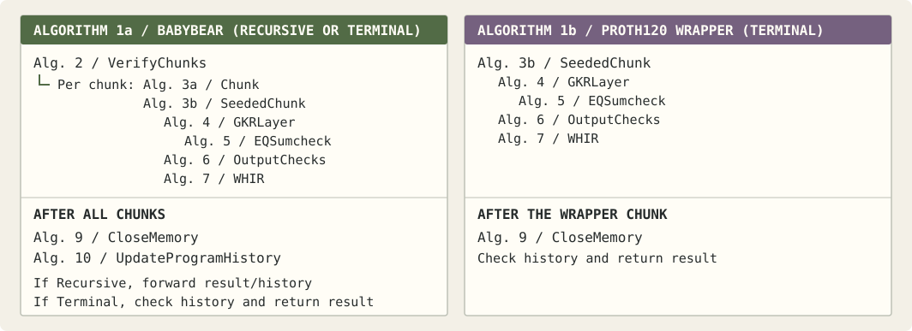

# Appendix — Protocol algorithms and soundness

Parameter reference: `Sec100` (Algorithm 12), `av_gkr_compiler` at [`c1a6622`](https://github.com/matter-labs/zksync-airbender/commit/c1a662222cafcd96db4383dce737edb79fa62b09).

See **Recursion chain** for how one proof feeds into the next.

> **Fiat–Shamir challenges**
>
> **Parameters:**
>
> - **BabyBear:** seven-round BLAKE2s with messages absorbed as raw 32-bit words. $E$ is BabyBear's quartic extension, with base modulus $p=2^{31}-2^{27}+1$.
> - **Proth120:** Keccak256 with field elements encoded as canonical 16-byte big-endian values and 32-bit messages, including boundary-state and Merkle-cap digest words, encoded little-endian. $E$ is the prime field with modulus $q=7\cdot2^{120}+1$. Each subsequent absorption of an encoded message $m$ updates the seed as $S\leftarrow\mathrm{Keccak256}(S\mathbin{\|}m)$.
>
> **Proof of work (PoW).** When challenge drawing requires $b$ bits of proof of work, Prover supplies a 64-bit nonce (encoded as eight big-endian bytes for Proth120), which both parties absorb into the transcript immediately before drawing. The first output word, 32 bits for BabyBear or 256 bits for Proth120, is reserved for PoW: Verifier accepts only if it has $b$ leading zero bits, and field challenges are sampled from subsequent drawn words. For Proth120 and only when sampling WHIR queries, the first 32-bit word following the 256-bit PoW digest is additionally discarded. At $b=0$, except for WHIR OOD draws (Algorithm 7, step 3.2) and WHIR sumcheck folding challenges (Algorithm 7, step 3.1.3), the nonce is still absorbed and the PoW word skipped, so every nonce passes.
>
> **Transcript flow across FullStatement.** In base/continuation mode, `FullStatement` first absorbs the final state (register values, PC and timestamps) and all chunks' memory commitments (Merkle tree caps), with circuit-family identifiers and RAM initialization/teardown window identifiers. These identify the circuit types and RAM ranges associated with the commitments. Before absorbing a Merkle-cap sequence, it zero-pads to the next block boundary; successive absorb calls otherwise concatenate without padding. This precommitment binds the selected memory events before the shared challenges $\mathbf{r}_{\mathrm{mem}}$ are drawn (Algorithms 1a and 2).
>
> Each chunk starts a fresh transcript by absorbing its window identifiers, $\mathbf{r}_{\mathrm{mem}}$, and commitments to its setup, memory and remaining witness, omitting absent witness groups (Algorithm 3a). Chunk transcripts proceed in parallel through GKR and WHIR; in the end, chunks' verified memory products are combined without further challenges.
>
> Prover prepares the memory commitments and computes the shared challenges before emitting the proof. Verifier reconstructs the memory transcript during `VerifyChunks` and authenticates the supplied challenges afterward.
>
> The `TerminalStatement` (Algorithm 1b) variant instead initializes one transcript by absorbing the final state, window identifiers, setup cap and merged memory/witness cap. After the combined memory/lookup PoW, both parties draw $\mathbf{r}_{\mathrm{mem}}$ followed by $\mathbf{r}_{\mathrm{lookup}}$ and continue that same transcript through GKR and WHIR.
>
> **Modular reduction sampling.** For BabyBear, each base-field challenge is a drawn 32-bit word reduced modulo $p$. Each extension-field challenge combines four such samples as coefficients in a fixed basis of $E$. Assuming independent uniform transcript words, each reduced coefficient has at most three preimages.
>
> For Proth120, let $S_0$ be the transcript seed before drawing. For each successive challenge $i\ge1$, compute $S_i=\mathrm{Keccak256}(S_{i-1})$ and reduce the first 128 bits of $S_i$, interpreted as a big-endian integer, modulo $q$. Retain $S_i$ as the seed for the next transcript operation. Assuming independent uniform hash outputs, each reduced field element has at most $\lceil2^{128}/q\rceil=37$ preimages among the 128-bit inputs.
>
> Assuming independent uniform hash output, for any fixed $a\in E$:
>
> $$
> \Pr[\text{challenge}=a]\le\mu=
> \begin{cases}
> (3/2^{32})^4=81/2^{128}\approx 2^{-121.66}, & \text{BabyBear},\\
> \lceil2^{128}/q\rceil/2^{128}=37/2^{128}\approx 2^{-122.79}, & \text{Proth120}.
> \end{cases}
> $$
>
> This accounts for modulo bias, so a fixed nonzero polynomial of total degree $d$ vanishes with probability $\le d\mu$ under independent challenge sampling.
>
> **Soundness.** In an idealized model with fresh, independent uniform draw words, for any algebraic check using challenges from a PoW-protected absorb–draw round and any transcript prefix and candidate nonce chosen before seeing those words:
>
> $$
> \Pr[\text{PoW check passes}\;\land\;\text{a false algebraic claim is accepted}] \le 2^{-b}\varepsilon
> $$
>
> where $\varepsilon$ bounds the algebraic soundness error of the ensuing protocol step, conditioned on the preceding transcript and no earlier soundness failure. The protocol analyses below determine $\varepsilon$, including sampling bias through $\mu$ and any permitted adaptive continuation. For BabyBear, Algorithm 12, step 5 selects PoW thresholds using $F=123$. It remains to show that these thresholds meet their target for the protected tests with $-\log_2\mu\approx121.66$ and the corresponding algebraic degrees. Composition accounts for all such rounds, adversarial attempts, and earlier soundness failures. A Fiat–Shamir soundness reduction in the random-oracle model remains to be established.

---

> **Algorithm 1 — Statement verification**
>
> Algorithm 1a is the BabyBear protocol’s entry point for recursive or terminal verification. Algorithm 1b is the Proth120 protocol’s entry point for terminal verification on L1.
>
> **Algorithm 1a — FullStatement**
>
> **Configuration**
>
> Prover and Verifier use common values for the following parameters, fixed throughout the protocol:
>
> - $\mathrm{profile}\in\{\mathrm{unrolled},\mathrm{unified}\}$. Unrolled uses separate instruction-family circuits; unified uses one combined instruction-family circuit (delegation circuits stay separate).
> - $\mathrm{mode}\in\{\mathrm{base},\mathrm{continuation}\}$. Base starts a new program-history chain and is meant for proving application execution; continuation validates and continues an incoming chain and is meant for proving recursive Verifier execution.
> - $\mathrm{commitment\text{-}config}\in\{\mathrm{ordinary},\;\mathrm{merged\text{-}feeder}\ \text{if}\ \mathrm{profile}=\mathrm{unified}\land\mathrm{mode}=\mathrm{continuation}\}$: ordinary uses separate Merkle trees for memory and remaining-witness columns; merged-feeder commits both column groups under one shared Merkle tree, except for delegation circuits. These options further impose restrictions on the WHIR (Algorithm 7) trace dimensions, LDE ratios, query counts, and PoW grinding difficulties selected for instruction circuits by Algorithm 12.
> - $\mathrm{chunk\text{-}config}=\mathrm{standard}$. Standard chunks use BabyBear with unpacked columns (Algorithm 3b).
> - $\mathrm{verification}\in\{\mathrm{recursive},\mathrm{terminal}\}$. Recursive forwards the application result and updated history digest in registers to the next layer. Terminal closes recursion by checking the digest against the caller's `ExpectedHistoryDigest`.
>
> **Input ($\mathrm{verification}=\mathrm{terminal}$):** `ExpectedHistoryDigest` for the program-history digest expected by the caller for this recursion path. **Output ($\mathrm{verification}=\mathrm{terminal}$):** the verified program's output $\mathbf{y}$, returned to the caller (the recursion chain uses $\mathbf{y}$ to forward the base program's result).
>
> **Protocol**
>
> 1. Prover sends `ProgramSetupCaps`, one program-dependent setup cap per instruction family selected by $\mathrm{profile}$ and $\mathrm{mode}$ (Algorithm 12). Each cap jointly commits to that family's committed setup columns, including any program-independent columns grouped with the program-dependent ones. Prover then sends the final RISC-V register values $x_0..x_{31}$ and timestamp limbs, then PC and timestamp limbs. The claimed final state contains 99 raw 32-bit words:
>
>    $$
>    \mathrm{fin}=\bigl((x_j,\mathrm{ts}_{j,\mathrm{lo}},\mathrm{ts}_{j,\mathrm{hi}})_{j=0}^{31},(\mathrm{pc},\mathrm{ts}_{\mathrm{pc},\mathrm{lo}},\mathrm{ts}_{\mathrm{pc},\mathrm{hi}})\bigr).
>    $$
>
>    Both parties initialize the memory transcript $T_{\mathrm{mem}}$ by absorbing $\mathrm{fin}$ in the order above, then zero-pad to fill the current input block (13 words). Verifier requires $x_0=0$.
> 2. Prover calculates and sends the claimed shared challenges:
>
>    $$
>    \mathbf{r}_{\mathrm{mem}}=(r_{\mathrm{mem},0},\ldots,r_{\mathrm{mem},5},r_{\mathrm{mem},\eta})\in E^7
>    $$
>
> 3. Run $\mathrm{VerifyChunks}(\mathtt{ProgramSetupCaps},\mathbf r_{\mathrm{mem}},T_{\mathrm{mem}})$ (Algorithm 2), obtaining the read/write products $\mathrm{RS},\mathrm{WS}\in E$ and the completed memory transcript $T_{\mathrm{mem}}$.
> 4. Prover sends the 64-bit memory-PoW nonce. Both parties absorb it into $T_{\mathrm{mem}}$, draw one 32-bit PoW word, then sample the shared challenges from subsequent words. Verifier requires at least 19 leading zero bits in the PoW word and equality between the sampled challenges and the supplied $\mathbf r_{\mathrm{mem}}$.
> 5. Run $\mathrm{CloseMemory}(\mathrm{fin},\mathbf{r}_{\mathrm{mem}},\mathrm{RS},\mathrm{WS})$ (Algorithm 9).
> 6. Run $\mathrm{UpdateProgramHistory}$ (Algorithm 10) with $\mathrm{fin}$ and `ProgramSetupCaps`, obtaining the updated program-history digest $h$.
> 7. Verifier rejects if any check or subalgorithm fails. Verifier reads the program output $\mathbf{y}=(x_{10},\ldots,x_{17})$ from $\mathrm{fin}$ (the base program's output, carried forward by each recursive verifier).
>
>    - **$\mathrm{verification}=\mathrm{recursive}$:** Verifier accepts, writes $\mathbf{y}$ to its own registers $x_{10},\ldots,x_{17}$ and $h$ to $x_{18},\ldots,x_{25}$, then exits successfully.
>    - **$\mathrm{verification}=\mathrm{terminal}$:**
>      1. **Terminal checks:** Verifier requires $h=\mathtt{ExpectedHistoryDigest}$, where $h$ includes the verified program’s identity.
>      2. On success, Verifier accepts and returns $\mathbf{y}$ to the caller.
>
> **Algorithm 1b — TerminalStatement**
>
> **Configuration**
>
> - $\mathrm{chunk\text{-}config}=\mathrm{terminal\text{-}wrapper}$. The single wrapper chunk uses Proth120 with packed columns (Algorithm 3b).
> - $\mathrm{verification}=\mathrm{terminal}$. Terminal closes recursion by checking the history digest, wrapper setup digest and final PC against their expected values (step 6).
>
> **Input:** `ExpectedHistoryDigest` for the program-history digest, `ExpectedSetupCapsDigest` for the wrapper setup digest, and `ExpectedFinalPC` for the successful exit PC, all values expected by the caller for this recursion path. **Output:** the verified program's output $\mathbf{y}$, returned to the caller as eight little-endian 32-bit words in register order (the recursion chain uses $\mathbf{y}$ to forward the base program's result).
>
> **Protocol**
>
> 1. Prover sends $\mathrm{fin}$ in the 99-word format from Algorithm 1a, step 1, followed by two RAM initialization/teardown window identifiers $\mathbf{b}$ as 32-bit values, then the wrapper chunk’s setup caps `SetupCaps` and memory caps `MemoryCaps`. The number of caps in each group and the number of hashes per cap are specified in Algorithm 12's terminal-wrapper entry. Verifier requires $\mathbf{b}=(0,1)$.
> 2. Both parties initialize $T_{\mathrm{mem{+}}}$ with seed $\mathrm{Keccak256}(\mathrm{fin}\mathbin{\|}\mathbf{b}\mathbin{\|}\mathtt{SetupCaps}\mathbin{\|}\mathtt{MemoryCaps})$, encoding the concatenation as little-endian 32-bit words.
> 3. Prover sends the 64-bit memory/lookup-PoW nonce. Both parties absorb it into $T_{\mathrm{mem{+}}}$ and draw one 256-bit PoW word. Verifier requires the number of leading zero bits to meet the combined memory/lookup-PoW threshold specified in Algorithm 12. Both parties then sample $\mathbf{r}_{\mathrm{mem}}=(r_{\mathrm{mem},0},\ldots,r_{\mathrm{mem},5},r_{\mathrm{mem},\eta})\in E^7$, followed by $\mathbf{r}_{\mathrm{lookup}}=(r_{\mathrm{lookup},\alpha},r_{\mathrm{lookup},\beta})\in E^2$, from subsequent drawn words.
> 4. Using circuit $C$ from Algorithm 12's terminal-wrapper entry, run $\mathrm{SeededChunk}(C,\mathbf{r}_{\mathrm{mem}},\mathbf{r}_{\mathrm{lookup}},\mathbf{b},(\mathtt{MemoryCaps},\varnothing,\mathtt{SetupCaps}),T_{\mathrm{mem{+}}})$ (Algorithm 3b), obtaining $(\mathrm{RS}_{\mathrm{chunk}},\mathrm{WS}_{\mathrm{chunk}})$ and $(\mathrm{RS}_{\mathrm{IT}},\mathrm{WS}_{\mathrm{IT}})$, together with the updated $T_{\mathrm{mem{+}}}$.
> 5. Run $\mathrm{CloseMemory}(\mathrm{fin},\mathbf{r}_{\mathrm{mem}},\mathrm{RS}_{\mathrm{chunk}}\mathrm{RS}_{\mathrm{IT}},\mathrm{WS}_{\mathrm{chunk}}\mathrm{WS}_{\mathrm{IT}})$ (Algorithm 9).
> 6. **Terminal checks:** Verifier reads the previous program-history digest $h_{\mathrm{prev}}=(x_{18},\ldots,x_{25})$ from $\mathrm{fin}$ and requires $h_{\mathrm{prev}}=\mathtt{ExpectedHistoryDigest}$. Verifier also requires $\mathrm{Keccak256}(\mathtt{SetupCaps})=\mathtt{ExpectedSetupCapsDigest}$ (hashing the cap digests in order as big-endian 32-bit words) and $\mathrm{pc}=\mathtt{ExpectedFinalPC}$ to check the feeder’s setup and final $\mathrm{pc}$ from $\mathrm{fin}$.
> 7. On success, Verifier accepts and returns $\mathbf{y}=(x_{10},\ldots,x_{17})$ from $\mathrm{fin}$ to the caller.
>
> **Soundness — statement composition (conditional)**
>
> **Standard path (Algorithm 1a; adapted).** For base/continuation mode, assume commitment binding, Algorithm 2's participant-binding lemma, and Algorithm 9's event-encoding and execution-reconstruction premises. Outside the chunk-verification failure events, all accepted chunks satisfy their local relations and export the correct selected memory-event products. Participant binding fixes the event multisets before memory-challenge sampling; Algorithm 1a, step 4 authenticates the supplied challenges against that transcript. Algorithm 9 then bounds acceptance of unequal read/write multisets by $\varepsilon_{\mathrm{mem}}\le N\mu$. If the multisets are equal, their boundary conditions and the local relations jointly imply an execution ending at $\mathrm{fin}$. Thus false execution acceptance requires a chunk-verification failure or a memory-fingerprint collision, giving
>
> $$
> \varepsilon_{\mathrm{exec}}\le\varepsilon_{\mathrm{mem}}+\sum_i\varepsilon_{\mathrm{chunk},i}.
> $$
>
> Here $\varepsilon_{\mathrm{chunk},i}$ includes all local lookup, GKR and PCS errors of Algorithm 3b, counted once, with the sum bounded over permitted participant collections. Each component bound must hold for adversarial choices conditioned on the preceding transcript and no earlier soundness failure. The resulting execution claim is relative to the supplied setup identities; Algorithm 10 binds the program history, and Algorithm 1a, step 7 checks it against the expected history for the chosen path.
>
> **Terminal path (Algorithm 1b; conditional).** Algorithm 1b fixes one circuit and absorbs $\mathrm{fin}$, window identifiers and setup/memory caps before drawing the memory and lookup challenges, then invokes the shared local verification in Algorithm 3b. Applying the same local-verification and memory-closure decomposition requires terminal-specific memory-table/event binding, event-count and Algorithm 9 reconstruction premises; Algorithm 2's participant-binding argument is not invoked. These remain proof obligations, together with the packed-claim reduction and configuration-specific opening guarantees identified below. Algorithm 1b, step 6 checks the wrapper identity and the carried history digest. The recursion-chain section supplies the recursive handoff premises.
>
> These component bounds enter the whole-system Fiat–Shamir analysis described in the final soundness section.

---

> **Algorithm 2 — VerifyChunks**
>
> **Configuration:** Inherit $\mathrm{profile}$, $\mathrm{mode}$, $\mathrm{commitment\text{-}config}$ and $\mathrm{chunk\text{-}config}$ from Algorithm 1a.
>
> **Input:** `ProgramSetupCaps` Merkle tree caps, $\mathbf{r}_{\mathrm{mem}}$ challenges, and the running memory transcript $T_{\mathrm{mem}}$ initialized with $\mathrm{fin}$. **Output:** accumulated read/write products $\mathrm{RS},\mathrm{WS}\in E$ and $T_{\mathrm{mem}}$ extended with the participating memory commitments and identifiers.
>
> 1. Verifier initializes $\mathrm{RS}\leftarrow1$, $\mathrm{WS}\leftarrow1$ and forms the ordered circuit list according to $\mathrm{profile}$:
>
>    - **$\mathrm{profile}=\mathrm{unrolled}$:** the instruction circuits selected by Algorithm 12 for $(\mathrm{profile},\mathrm{mode})$, in their listed order; then the standalone IT circuit; then the delegation circuits in Algorithm 12's fixed order.
>    - **$\mathrm{profile}=\mathrm{unified}$:** the unified instruction circuit; then the delegation circuits in Algorithm 12's fixed order.
>
> 2. For each circuit $C$ in this list:
>
>    1. Prover sends the chunk count $n$: the number of proofs for the selected circuit. Each proof covers one chunk, a trace with the fixed number of rows specified for that circuit in Algorithm 12. If the selected circuit is the unified instruction circuit, Prover sends two counts: the total $n$ and the number $n_{IT}$ of final chunks whose initialization/teardown products also contribute to the memory argument (see step 2.3.4).
>    2. Verifier checks the chunk counts:
>
>       - **Standalone IT circuit:** Verifier requires $1\le n \le 8$.
>       - **Unified instruction circuit:** Verifier requires $1\le n_{\mathrm{IT}}\le n$.
>
>    3. For each chunk, in proof order:
>
>       1. Verifier runs $\mathrm{Chunk}(C,\mathbf{r}_{\mathrm{mem}})$† (Algorithm 3a), obtaining the chunk's main read/write products $(\mathrm{RS}_{\mathrm{chunk}},\mathrm{WS}_{\mathrm{chunk}})$, the additional initialization/teardown products $(\mathrm{RS}_{\mathrm{IT}},\mathrm{WS}_{\mathrm{IT}})$ for unified instruction chunks, memory caps `MemoryCaps`, setup caps `SetupCaps` and window identifiers $\mathbf{b}$.
>
>          † _Chunk calls may run in parallel, each consuming the separate, non-overlapping portion of proof data corresponding to that chunk._
>
>       2. Verifier checks the returned outputs according to $C$:
>
>          - **Unrolled instruction circuit:** require $\mathbf{b}$ to be empty and `SetupCaps` to match the cap for $C$ in `ProgramSetupCaps`.
>          - **Unified instruction circuit:** require two window identifiers in $\mathbf{b}$ and `SetupCaps` to match the cap for $C$ in `ProgramSetupCaps`. For the first $n-n_{\mathrm{IT}}$ chunks, require $\mathbf{b}=(0,0)$. Across the final $n_{\mathrm{IT}}$ chunks, require the window identifiers, in proof order, to form a strictly increasing sequence in $[0,64)$.
>          - **Standalone IT circuit:** require eight window identifiers in $\mathbf{b}$ and require the identifiers, in proof order across chunks, to form a strictly increasing sequence in $[0,64)$. This circuit has no committed setup tables, so `SetupCaps` is empty and requires no comparison.
>          - **Delegation circuit:** require $\mathbf{b}$ to be empty and `SetupCaps` to match the Verifier's hardcoded cap for $C$.
>
>       3. Both parties absorb the following into $T_{\mathrm{mem}}$, using $C$'s 32-bit family label from Algorithm 12:
>
>          - **Unrolled instruction or delegation circuit:** if this is the first chunk for $C$, absorb its family label padded with fifteen zero words. Then absorb this chunk's `MemoryCaps`.
>          - **Standalone IT circuit:** if this is the first chunk for $C$, absorb its family label padded with fifteen zero words. Then absorb this chunk's `MemoryCaps`, followed by its eight window identifiers $\mathbf{b}$ padded with eight zero words.
>          - **Unified instruction circuit:** absorb $C$'s family label and this chunk's two window identifiers $\mathbf{b}$, padded with thirteen zero words. Then absorb this chunk's `MemoryCaps`.
>       4. Update $\mathrm{RS}\leftarrow\mathrm{RS}\cdot\mathrm{RS}_{\mathrm{chunk}}$ and $\mathrm{WS}\leftarrow\mathrm{WS}\cdot\mathrm{WS}_{\mathrm{chunk}}$. For the final $n_{\mathrm{IT}}$ unified instruction chunks, Verifier also updates $\mathrm{RS}\leftarrow\mathrm{RS}\cdot\mathrm{RS}_{\mathrm{IT}}$ and $\mathrm{WS}\leftarrow\mathrm{WS}\cdot\mathrm{WS}_{\mathrm{IT}}$.
> 3. Verifier requires the following memory-term capacity bounds, using the fixed circuit parameters listed before Algorithm 12. The bounds count only one side of the memory argument ($\mathrm{RS}$ or $\mathrm{WS}$), for soundness analysis purposes:
>
>    - **Instruction cycles $<2^{36}$:** count each unrolled instruction chunk by its trace rows, or each unified instruction chunk as $2^{24}$ cycles.
>    - **Non-IT memory-argument terms $<2^{40}$:** For each instruction chunk, count four terms per cycle (the fixed bound used for all instruction circuits), using the cycle count specified above. For each delegation chunk, count its rows multiplied by its terms per row, using the fixed circuit parameters listed before Algorithm 12. Sum these contributions across all instruction and delegation chunks and require the total to be below $2^{40}$.
>
>    The remaining contributions are accounted for separately:
>
>    - **Standalone-IT memory-argument terms $\le 2^{30}$:** this follows from the earlier limit of eight chunks and the fixed eight windows of $2^{24}$ terms per chunk (listed before Algorithm 12).
>    - **Unified-IT memory-argument terms $\le 2^{29}$:** the identifier checks permit at most 64 distinct windows, each contributing $2^{23}$ terms (listed before Algorithm 12).
>    - **33 machine-state boundary terms:** Algorithm 9, step 2 adds 33 initialization writes to $\mathrm{WS}$ and 33 final-state reads to $\mathrm{RS}$, one for each register and the PC.
>
> 4. Return $\mathrm{RS},\mathrm{WS},T_{\mathrm{mem}}$.
>
> **Soundness — participant/window binding (new, conditional).** Assume Algorithm 3b's local correctness. The required precommitment guarantee links the participating circuits, their memory data and window identifiers to the memory events tested by Algorithm 9, before the shared memory challenges are sampled. Participant interpretation despite the omitted proof counts, and memory-table binding exported by Algorithm 7 through Algorithm 3b, are the two parts of this requirement. Both remain conditional imports here. Together they justify the fingerprint analysis; local circuit correctness and Algorithm 9's memory-consistency and reconstruction arguments then connect the accepted events to the claimed computation.
>
> For each fixed circuit, its committed memory columns and window identifiers determine the exported events. Addresses, values, timestamps and execution selectors come from those columns or fixed circuit constants; initialization/teardown addresses combine the window identifiers with fixed virtual row addresses. The circuit's access layout and execution selectors determine multiplicities and inactive-row contributions. Program setup and separate witness columns constrain whether these values satisfy the circuit, but cannot change the exported events in a locally correct completion with the same memory columns, circuit and identifiers. This explains why their omission from the memory prefix preserves the events under the stated binding assumptions.
>
> The bound participant list fixes the chunk counts. For unified chunks, excluded identifier pairs are $(0,0)$ and selected pairs are strictly increasing, so the identifiers fix the contributing suffix. The absorbed final state fixes Algorithm 9's register/PC boundary events. Algorithm 2 therefore accumulates the prescribed products of events fixed before the shared challenges; its capacity accounting bounds their number. After Algorithm 1a authenticates those challenges, Algorithm 9 supplies the memory-fingerprint bound and the event-encoding, RAM-boundary-coverage and execution-reconstruction premises.
>
> **TODO — numerical composition:** after resolving participant binding and Algorithm 7's memory-table binding export, account for any candidate-list or alternative-interpretation losses, combine them with the imported local and memory-fingerprint errors, and charge each failure once.
>
> **Retained draft obligations (to reconcile with the argument above):**
>
> Required participant-binding lemma: under commitment binding, for each fixed memory-transcript prefix immediately before the nonce, all completions satisfying the local chunk relations and participant checks induce the same selected read/write event multisets, including multiplicities and Algorithm 9's boundary events, independently of the subsequently sampled memory challenges. Its proof must establish that the encoding fixes the participating caps and their interpretation sufficiently to determine these multisets. In particular, proof counts, `ProgramSetupCaps` and separate witness caps are omitted from this prefix: varying them while preserving the prefix must not change event selection, tuple values or multiplicities. Later absorption of setup/witness caps into chunk transcripts does not establish this earlier binding. This lemma remains a proof obligation.
>
> For unified chunks, the authenticated window identifiers determine which IT products contribute: excluded chunks have $\mathbf{b}=(0,0)$, whereas selected chunks have strictly increasing identifiers. Once the ordered chunk list and its identifiers are bound, these conditions uniquely determine the selected suffix and $n_{\mathrm{IT}}$. Establishing that the selected IT windows supply every RAM boundary required by the execution remains part of Algorithm 9's reconstruction lemma.
>
> Outside local verification failures, setup-cap equality ties instruction chunks to the supplied program setups and delegation chunks to the fixed delegation setups. Circuit-bound, strictly increasing IT windows exclude repeated initialization/teardown windows; complete coverage remains a premise of Algorithm 9's reconstruction lemma. The capacity argument must additionally show that the charged counts bound all selected events, including IT and boundary events in the final $N$ bound. Subject to these obligations, the accumulated products are fingerprints of the fixed multisets, so Algorithm 9's collision bound applies after Algorithm 1a authenticates the shared challenges.

---

> **Algorithm 3 — Chunk preparation and verification**
>
> On the BabyBear path (Algorithm 1a, $\mathrm{chunk\text{-}config}=\mathrm{standard}$), Algorithm 2 calls Algorithm 3a to prepare each chunk for verification by Algorithm 3b. On the Proth120 wrapper path (Algorithm 1b, $\mathrm{chunk\text{-}config}=\mathrm{terminal\text{-}wrapper}$), the caller prepares its single chunk and calls Algorithm 3b directly.
>
> **Algorithm 3a — Chunk**
>
> **Configuration:** Inherit $\mathrm{chunk\text{-}config}$ and $\mathrm{commitment\text{-}config}$ from Algorithm 2.
>
> **Input:** compiled arithmetic circuit $C$ and memory challenges $\mathbf{r}_{\mathrm{mem}}$. **Output:** read/write products $(\mathrm{RS}_{\mathrm{chunk}},\mathrm{WS}_{\mathrm{chunk}})$, the additional initialization/teardown products $(\mathrm{RS}_{\mathrm{IT}},\mathrm{WS}_{\mathrm{IT}})$ for unified instruction chunks, memory caps `MemoryCaps`, setup caps `SetupCaps` and window identifiers $\mathbf{b}$.
>
> 1. Prover sends the RAM initialization/teardown window identifiers $\mathbf{b}$ as 32-bit values according to $C$:
>
>    - **Standalone IT circuit:** eight values.
>    - **Unified instruction circuit:** two values.
>    - **Otherwise:** $\mathbf{b}$ is empty and no values are sent.
>
> 2. Prover sends `SetupCaps`, `MemoryCaps` and `WitnessCaps` in that order, using the layout specified by Algorithm 12 for $C$ and $\mathrm{commitment\text{-}config}$ (number of caps per group) and for $\mathrm{chunk\text{-}config}=\mathrm{standard}$ (number of 256-bit hashes per cap).
>
> 3. Both parties start a fresh transcript $T_{\mathrm{chunk}}$ by absorbing the ordered prefix below:
>
>    $$
>    \mathbf{b}\mathbin{\|}\mathbf{r}_{\mathrm{mem}}\mathbin{\|}\mathtt{SetupCaps}\mathbin{\|}\mathtt{MemoryCaps}\mathbin{\|}\mathtt{WitnessCaps}
>    $$
>
> 4. Prover sends the 64-bit lookup-PoW nonce. Both parties absorb it into $T_{\mathrm{chunk}}$ and draw one 32-bit PoW word. Verifier requires the number of leading zero bits to meet the lookup-PoW threshold specified in Algorithm 12. Both parties then sample the lookup challenges $\mathbf{r}_{\mathrm{lookup}}=(r_{\mathrm{lookup},\alpha},r_{\mathrm{lookup},\beta})\in E^2$ from subsequent words.
> 5. Run $\mathrm{SeededChunk}(C,\mathbf{r}_{\mathrm{mem}},\mathbf{r}_{\mathrm{lookup}},\mathbf{b},(\mathtt{MemoryCaps},\mathtt{WitnessCaps},\mathtt{SetupCaps}),T_{\mathrm{chunk}})$ (Algorithm 3b), obtaining $(\mathrm{RS}_{\mathrm{chunk}},\mathrm{WS}_{\mathrm{chunk}})$, the additional pair $(\mathrm{RS}_{\mathrm{IT}},\mathrm{WS}_{\mathrm{IT}})$ when present, and the updated $T_{\mathrm{chunk}}$.
> 6. Return $(\mathrm{RS}_{\mathrm{chunk}},\mathrm{WS}_{\mathrm{chunk}})$ and $(\mathrm{RS}_{\mathrm{IT}},\mathrm{WS}_{\mathrm{IT}})$, when present, from step 5, together with `MemoryCaps`, `SetupCaps` and $\mathbf{b}$ from steps 1–2.
>
> **Algorithm 3b — SeededChunk**
>
> **Configuration:** Inherit $\mathrm{chunk\text{-}config}$ from the caller. For $\mathrm{chunk\text{-}config}=\mathrm{standard}$, also inherit $\mathrm{commitment\text{-}config}$.
>
> **Input:** compiled arithmetic circuit $C$, memory challenges $\mathbf{r}_{\mathrm{mem}}$, lookup challenges $\mathbf{r}_{\mathrm{lookup}}$, window identifiers $\mathbf{b}$, cap groups $(\mathtt{MemoryCaps},\mathtt{WitnessCaps},\mathtt{SetupCaps})$ and the prepared transcript $T_{\mathrm{chunk}}$. **Output:** read/write products $(\mathrm{RS}_{\mathrm{chunk}},\mathrm{WS}_{\mathrm{chunk}})$, the additional initialization/teardown products $(\mathrm{RS}_{\mathrm{IT}},\mathrm{WS}_{\mathrm{IT}})$ for unified instruction chunks, and the updated transcript $T_{\mathrm{chunk}}$.
>
> 1. Both parties run GKR:
>
>    1. Prover sends $s$ claimed output tables $A_0,\ldots,A_{s-1}$ of $C$, each containing sixteen elements of $E$, with $s$ and the table order specified by $C$'s output layout in Algorithm 12. Both parties absorb the tables into $T_{\mathrm{chunk}}$ as one concatenated message in that order, then sample the GKR evaluation point $\mathbf{z}_{\mathrm{gkr}}=(z_{\mathrm{gkr},0},\ldots,z_{\mathrm{gkr},3})\in E^4$ and batching challenge $r_{\mathrm{batch},\mathrm{gkr}}\in E$.
>    2. Initialize $\mathbf{a}_{\mathrm{gkr}}\leftarrow(\mathrm{MLE}(A_0)(\mathbf{z}_{\mathrm{gkr}}),\ldots,\mathrm{MLE}(A_{s-1})(\mathbf{z}_{\mathrm{gkr}}))$, where $\mathrm{MLE}(A)$ is $A$'s multilinear extension.
>    3. Let $2^n$ be $C$'s trace row count from Algorithm 12. Process $C$'s compression layers for $k=4,\ldots,n-1$, followed by its main layers from outputs towards inputs. For each layer $C_{\mathrm{layer}}$, update using Algorithm 4:
>
>       $$
>       ((\mathbf{z}_{\mathrm{gkr}},\mathbf{a}_{\mathrm{gkr}}),r_{\mathrm{batch},\mathrm{gkr}},T_{\mathrm{chunk}})\leftarrow\mathrm{GKRLayer}(C_{\mathrm{layer}},(\mathbf{z}_{\mathrm{gkr}},\mathbf{a}_{\mathrm{gkr}}),r_{\mathrm{batch},\mathrm{gkr}},\mathbf{r}_{\mathrm{mem}},\mathbf{r}_{\mathrm{lookup}},\mathbf{b},T_{\mathrm{chunk}}).
>       $$
>    4. Take the column-packing factor $\mathrm{pack}=2^k$ from Algorithm 12 using $\mathrm{chunk\text{-}config}$.
>
>       - **$k=0$:** set $(\mathbf{z}_{\mathrm{whir}},\mathbf{a}_{\mathrm{whir}})\leftarrow(\mathbf{z}_{\mathrm{gkr}},\mathbf{a}_{\mathrm{gkr}})$.
>       - **$k>0$:** Pad each of the two groups in $\mathbf{a}_{\mathrm{gkr}}$, the merged memory/witness claims and the setup claims as specified in Algorithm 12, with trailing zeros to a multiple of $\mathrm{pack}$ entries, preserving their order. Both parties sample $(z_{\mathrm{gkr},n},\ldots,z_{\mathrm{gkr},n+k-1})\in E^k$ from $T_{\mathrm{chunk}}$. Set:
>
>         $$
>         \begin{aligned}
>         \mathbf{a}_{\mathrm{whir}}&\leftarrow\bigl(\mathrm{MLE}((a_{\mathrm{gkr},0},\ldots,a_{\mathrm{gkr},\mathrm{pack}-1}))(z_{\mathrm{gkr},n},\ldots,z_{\mathrm{gkr},n+k-1}),\\
>         &\qquad\mathrm{MLE}((a_{\mathrm{gkr},\mathrm{pack}},\ldots,a_{\mathrm{gkr},2\mathrm{pack}-1}))(z_{\mathrm{gkr},n},\ldots,z_{\mathrm{gkr},n+k-1}),\ldots\bigr),\\
>         \mathbf{z}_{\mathrm{whir}}&\leftarrow(\mathbf{z}_{\mathrm{gkr}},z_{\mathrm{gkr},n},\ldots,z_{\mathrm{gkr},n+k-1}).
>         \end{aligned}
>         $$
>
> 2. Run $\mathrm{OutputChecks}(C,A_0,\ldots,A_{s-1})$ (Algorithm 6), obtaining the read/write products $(\mathrm{RS}_{\mathrm{chunk}},\mathrm{WS}_{\mathrm{chunk}})$ and, if $C$ is the unified instruction circuit, the additional initialization/teardown products $(\mathrm{RS}_{\mathrm{IT}},\mathrm{WS}_{\mathrm{IT}})$.
>
> 3. Prover sends the 64-bit batching/proximity-PoW nonce. Both parties absorb it into $T_{\mathrm{chunk}}$ and draw one 32-bit PoW word (256-bit for Proth120 transcript). Verifier requires the number of leading zero bits to meet the batching-PoW threshold specified in Algorithm 12 for $C$, $\mathrm{chunk\text{-}config}$ and, for standard chunks, $\mathrm{commitment\text{-}config}$. Both parties then sample the WHIR batching challenge $r_{\mathrm{batch},\mathrm{whir}}\in E$ from subsequent words.
>
> 4. Set $T_{\mathrm{chunk}}\leftarrow\mathrm{WHIR}(C,(\mathtt{MemoryCaps},\mathtt{WitnessCaps},\mathtt{SetupCaps}),(\mathbf{z}_{\mathrm{whir}},\mathbf{a}_{\mathrm{whir}}),r_{\mathrm{batch},\mathrm{whir}},T_{\mathrm{chunk}})$ (Algorithm 7).
>
> 5. Return $(\mathrm{RS}_{\mathrm{chunk}},\mathrm{WS}_{\mathrm{chunk}})$, the additional pair $(\mathrm{RS}_{\mathrm{IT}},\mathrm{WS}_{\mathrm{IT}})$ when present, and the updated $T_{\mathrm{chunk}}$.
>
> **Soundness — chunk verification (conditional)**
>
> **Preparation premises.** Algorithm 3a supplies the standard prefix and lookup challenges; Algorithm 1b supplies the terminal prefix and both challenge sets. Algorithm 3b continues the supplied transcript without reinitialization. The local argument below assumes the required lookup-data binding before lookup sampling on either path; merely supplying a transcript does not establish that premise. Standard memory-challenge authentication and participant binding remain in Algorithms 1a and 2, while the terminal obligations are stated in Algorithm 1b's soundness discussion.
>
> **Shared local composition (Algorithm 3b; adapted, conditional).** Fix the circuit, layout and shared memory challenges. Assume binding commitments, the layer-reduction premises of Algorithm 4 and the opening guarantee of Algorithm 7. Lookup tuples, selectors, tables and multiplicities must be determined by committed columns or public data before $\mathbf{r}_{\mathrm{lookup}}$ is sampled. Outside the GKR and PCS failure events, the supplied output tables are the circuit's actual outputs and its zero constraints hold. Algorithm 6 then establishes lookup membership, except with error $\varepsilon_{\mathrm{lookup}}$, and returns the selected memory products. Hence
>
> $$
> \varepsilon_{\mathrm{chunk}}\le\varepsilon_{\mathrm{GKR}}+\varepsilon_{\mathrm{PCS}}+\varepsilon_{\mathrm{lookup}}.
> $$
>
> **Memory-table binding export (conditional).** For Algorithm 2, additionally import Algorithm 7's memory-table binding guarantee below: outside the accounted commitment/PCS failures, the memory columns used by the accepted local relations are fixed by the memory precommitment before $\mathbf r_{\mathrm{mem}}$ is sampled. The local correctness argument must use those same columns. Establishing this timing and consistency remains a proof obligation in Algorithm 7; any candidate-list alternative and its losses must be carried through to Algorithm 2's memory analysis.
>
> Algorithm 4 owns the algebraic verification of the product/rational compression trees; Algorithm 6 owns the lookup fingerprint error; Algorithm 7 owns base-claim batching and opening verification. Algorithm 1a uses the resulting local relation with Algorithm 2's event binding and Algorithm 9's reconstruction premises. The displayed bound covers the unpacked BabyBear path; packed variants require an additional reduction for the pack-coordinate claim merge.

---

> **Algorithm 4 — GKRLayer**
>
> **Input:** fixed circuit layer $C_{\mathrm{layer}}$, output evaluation point $\mathbf{z}_{\mathrm{gkr}}$ and claims $\mathbf{a}_{\mathrm{gkr}}$, batching challenge $r_{\mathrm{batch},\mathrm{gkr}}$, shared memory challenges $\mathbf{r}_{\mathrm{mem}}$, lookup challenges $\mathbf{r}_{\mathrm{lookup}}$, window identifiers $\mathbf{b}$ and the running chunk transcript $T_{\mathrm{chunk}}$. **Output:** preceding-layer evaluation point $\mathbf{z}'_{\mathrm{gkr}}$, claims $\mathbf{a}'_{\mathrm{gkr}}$, next batching challenge $r'_{\mathrm{batch},\mathrm{gkr}}$, and the updated transcript $T_{\mathrm{chunk}}$.
>
> 1. Both parties batch the incoming claims $\mathbf{a}_{\mathrm{gkr}}$ via RLC using powers of $r_{\mathrm{batch},\mathrm{gkr}}$ in the order specified by $C_{\mathrm{layer}}$, obtaining the initial sumcheck claim $v_{\mathrm{sumcheck}}$.
>
> 2. Run $\mathrm{EQSumcheck}(C_{\mathrm{layer}},(\mathbf{z}_{\mathrm{gkr}},v_{\mathrm{sumcheck}}),T_{\mathrm{chunk}})$ (Algorithm 5) for the layer's batched gate polynomial, obtaining the sumcheck evaluation point $\mathbf{z}_{\mathrm{sumcheck}}$, scalar residual claim $v_{\mathrm{sumcheck}}$, final-coordinate EQ factor $e$ and updated transcript $T_{\mathrm{chunk}}$.
>
> 3. Prover sends $\mathbf{a}_{\mathrm{sumcheck}}$: claimed evaluations of all input polynomials required by $C_{\mathrm{layer}}$ and, for main layers only, cached relation outputs (including claimed virtual-setup polynomial evaluations), in $C_{\mathrm{layer}}$'s prescribed evaluation order.
>
> 4. Verifier evaluates the gates specified by $C_{\mathrm{layer}}$ using the following entries of $\mathbf{a}_{\mathrm{sumcheck}}$:
>
>    - **Compression layer:** Verifier combines the pairwise claimed evaluations at $(0,\mathbf{z}_{\mathrm{sumcheck}})$ and $(1,\mathbf{z}_{\mathrm{sumcheck}})$ using the layer's memory-product or rational-sum LogUp accumulation relations.
>
>    - **Main layer:** Verifier uses the gate-input evaluations at $\mathbf{z}_{\mathrm{sumcheck}}$, including cached relation outputs where applicable, to evaluate copy/linear relations, quadratic arithmetic, memory-product and lookup relations (using $\mathbf{r}_{\mathrm{mem}}$, $\mathbf{r}_{\mathrm{lookup}}$ and $\mathbf{b}$ where required), and zero-constraint expressions as specified by $C_{\mathrm{layer}}$'s gates. Verifier also evaluates the cached relations using claimed inputs from $\mathbf{a}_{\mathrm{sumcheck}}$ where needed and computes virtual lookup-table expressions directly at $\mathbf{z}_{\mathrm{sumcheck}}$. He requires the claimed cached outputs, including virtual setup evaluations, to equal the corresponding computed values.
>
>
>    Verifier batches the resulting scalar gate evaluations using the same powers of $r_{\mathrm{batch},\mathrm{gkr}}$ and the same order as in step 1. He then scales this batch by the final-coordinate EQ factor $e$ returned by Algorithm 5, and requires the result to equal $v_{\mathrm{sumcheck}}$.
>
> 5. Both parties update the transcript and draw challenges according to the layer type:
>
>    - **Compression layer:** Both parties absorb $\mathbf{a}_{\mathrm{sumcheck}}$ into $T_{\mathrm{chunk}}$ and draw $z_{\mathrm{sumcheck},\mathrm{pair}}$ for interpolating the endpoint claims and $r'_{\mathrm{batch},\mathrm{gkr}}$ for batching the next layer's claims.
>
>    - **Main layer:** Both parties absorb $\mathbf{a}_{\mathrm{sumcheck}}$ into $T_{\mathrm{chunk}}$ and draw $r'_{\mathrm{batch},\mathrm{gkr}}$ for batching the next layer's claims.
>
> 6. Both parties prepare the preceding-layer point and claims according to the layer type:
>
>    - **Compression layer:** Both parties set $\mathbf{z}'_{\mathrm{gkr}}\leftarrow(z_{\mathrm{sumcheck},\mathrm{pair}},\mathbf{z}_{\mathrm{sumcheck}})$ and obtain $\mathbf{a}'_{\mathrm{gkr}}$ by evaluating the MLE of each pair in $\mathbf{a}_{\mathrm{sumcheck}}$ at $z_{\mathrm{sumcheck},\mathrm{pair}}$.
>
>    - **Main layer:** Both parties set $\mathbf{z}'_{\mathrm{gkr}}\leftarrow\mathbf{z}_{\mathrm{sumcheck}}$ and obtain $\mathbf{a}'_{\mathrm{gkr}}$ by filtering $\mathbf{a}_{\mathrm{sumcheck}}$ to retain only claimed evaluations of input polynomials, then reordering them according to the next layer's layout or, for the final main layer, the fixed WHIR order: memory, witness, setup, with increasing column index within each group.
>
> 7. Both parties return $(\mathbf{z}'_{\mathrm{gkr}},\mathbf{a}'_{\mathrm{gkr}},r'_{\mathrm{batch},\mathrm{gkr}},T_{\mathrm{chunk}})$.
>
> **Soundness — layer reduction and GKR budget (adapted, conditional).** Assume the fixed layer wiring and auxiliary identities implement the claimed gate relation, its batched gate polynomial satisfies Algorithm 5's degree bound, and each claimed value is fixed before the challenge testing it. Algorithm 5 reduces a false batched output claim to a false gate evaluation. The gate check then forces a false preceding-layer claim; auxiliary and public-polynomial checks must establish the identities used in this implication. In a compression layer, fixed endpoint discrepancies define a nonzero linear polynomial in $z_{\mathrm{sumcheck},\mathrm{pair}}$, so interpolation hides them with probability at most $\mu$. Induction through the layers terminates at the base openings established by Algorithm 7.
>
> For the complete GKR path in Algorithm 3b, a false sixteen-entry output table survives evaluation at $\mathbf{z}_{\mathrm{gkr}}\in E^4$ with probability at most $4\mu$; batching $b$ fixed scalar claims costs at most $(b-1)\mu$. Let $B$ be the sum of all power-batching degrees, including the initial output batch; $R$ the total number of EQSumcheck rounds; $Z\le R$ the charged EQ-zero events; and $S$ the sum of the remaining point/line-test degrees, including endpoint interpolation. Then
>
> $$
> \varepsilon_{\mathrm{GKR}}\le\min(1,\mu(4+B+3R+Z+S)).
> $$
>
> For $L$ main layers each using $n$ rounds, $R=\sum_{k=4}^{n-1}k+Ln$. These are proof-accounting quantities determined by the selected circuit. Completing the bound requires the layer/auxiliary-relation induction and explicit $B,R,Z,S$ counts for that circuit; lookup fingerprinting and base-opening errors are composed in Algorithm 3b.

---

> **Algorithm 5 — EQSumcheck**
>
> **Input:** fixed circuit layer $C_{\mathrm{layer}}$ of degree at most 2, incoming point $\mathbf{z}_{\mathrm{gkr}}$, initial batched claim $v_{\mathrm{sumcheck}}$ and the running chunk transcript $T_{\mathrm{chunk}}$. **Output:** point $\mathbf{z}_{\mathrm{sumcheck}}$, updated scalar residual claim $v_{\mathrm{sumcheck}}$, final-coordinate EQ factor $e$, and the updated transcript $T_{\mathrm{chunk}}$.
>
>> This algorithm reduces the initial weighted sum claim below to a polynomial evaluation claim. Here $m$ is the number of coordinates of $\mathbf{z}_{\mathrm{gkr}}$, $G$ is the batched gate polynomial computed in step 2, and $\mathrm{eq}$ is the Boolean-cube interpolation kernel:
>>
>> $$
>> \begin{aligned}
>> v_{\mathrm{sumcheck}}&=\sum_{\mathbf{x}\in\{0,1\}^m}\mathrm{eq}(\mathbf{z}_{\mathrm{gkr}},\mathbf{x})G(\mathbf{x}),\\
>> \mathrm{eq}(\mathbf{u},\mathbf{x})&=\prod_j((1-u_j)(1-x_j)+u_jx_j).
>> \end{aligned}
>> $$
>>
> 1. Both parties initialize $e\leftarrow1$.
> 2. Prover computes $G\in E^{\le2}[X_0,\ldots,X_{m-1}]$ (degree at most two in each variable) by batching the layer gate expressions from Algorithm 4, step 4, with the same powers of $r_{\mathrm{batch},\mathrm{gkr}}$ and ordering as in Algorithm 4, step 1.
> 3. Both parties run the following rounds for $j=0,\ldots,m-1$:
>    1. Prover computes the univariate round polynomial
>
>       $$
>       g_j(X)=\mathrm{eq}(z_{\mathrm{gkr},j},X)\sum_{\mathbf{x}'\in\{0,1\}^{m-j-1}}\mathrm{eq}(\mathbf{z}_{\mathrm{gkr},>j},\mathbf{x}')G(\mathbf{z}_{\mathrm{sumcheck},<j},X,\mathbf{x}')
>       $$
>
>       and sends its coefficients, with $\deg g_j\le3$.
>    2. Verifier requires $e\,(g_j(0)+g_j(1))=v_{\mathrm{sumcheck}}$.
>    3. Both parties absorb the coefficients of $g_j$ into $T_{\mathrm{chunk}}$, then draw $z_{\mathrm{sumcheck},j}\in E$.
>    4. Both parties update:
>
>       $$
>       \begin{aligned}
>       v_{\mathrm{sumcheck}} &\leftarrow g_j(z_{\mathrm{sumcheck},j}) \\
>       e &\leftarrow \mathrm{eq}(z_{\mathrm{gkr},j},z_{\mathrm{sumcheck},j})
>       \end{aligned}
>       $$
>
> 4. Both parties return $(\mathbf{z}_{\mathrm{sumcheck}},v_{\mathrm{sumcheck}},e,T_{\mathrm{chunk}})$, leaving the residual claim $v_{\mathrm{sumcheck}}=e\,G(\mathbf{z}_{\mathrm{sumcheck}})$ to be checked by the caller algorithm.
>
> **Soundness — Sumcheck and EQ factoring (adapted).** Assume $\mathbf{z}_{\mathrm{gkr}}$ and the polynomial $G$ are fixed before this call's challenges, $G$ has individual degree at most two, and every round polynomial is fixed before its evaluation challenge. For a false incoming claim and a nonzero carried EQ factor $e$, the endpoint check forces the sent cubic to differ from the honest round polynomial. That discrepancy vanishes at $z_{\mathrm{sumcheck},j}$ with probability at most $3\mu$. The new EQ factor is $1-z_{\mathrm{gkr},j}+(2z_{\mathrm{gkr},j}-1)z_{\mathrm{sumcheck},j}$: it is $1/2$ if $z_{\mathrm{gkr},j}=1/2$, and otherwise vanishes with probability at most $\mu$.
>
> Charging each potentially vanishing factor as an exceptional event, a false incoming sum reduces to a false final claim $v_{\mathrm{sumcheck}}=eG(\mathbf{z}_{\mathrm{sumcheck}})$ except with probability at most $\min(1,(3m+Z)\mu)$, where $Z\le m$. Algorithm 4 receives the input evaluations and checks the final gate evaluation against this residual claim; its auxiliary checks and layer-reduction premises remain necessary. Algorithm 4 counts this reduction error once in its layer budget.

---

> **Algorithm 6 — OutputChecks: memory products and LogUp**
>
> **Input:** compiled arithmetic circuit $C$ and its claimed output tables $A_0,\ldots,A_{s-1}\in E^{16}$, received in Algorithm 3b, step 1.1. **Output:** read/write products $(\mathrm{RS}_{\mathrm{chunk}},\mathrm{WS}_{\mathrm{chunk}})$ and, for unified instruction circuits, the additional initialization/teardown products $(\mathrm{RS}_{\mathrm{IT}},\mathrm{WS}_{\mathrm{IT}})$.
>
> 1. Verifier selects the two main read/write tables $(A_{\mathrm{RS},\mathrm{chunk}},A_{\mathrm{WS},\mathrm{chunk}})$ from $A_0,\ldots,A_{s-1}$ according to $C$'s output layout. For standalone IT circuits, these are the initialization/teardown tables. He computes the product of the entries in each table:
>
>    $$
>    \begin{aligned}
>    \mathrm{RS}_{\mathrm{chunk}} &\leftarrow \prod_{j=0}^{15}A_{\mathrm{RS},\mathrm{chunk}}[j] \\
>    \mathrm{WS}_{\mathrm{chunk}} &\leftarrow \prod_{j=0}^{15}A_{\mathrm{WS},\mathrm{chunk}}[j]
>    \end{aligned}
>    $$
>
>    If $C$ is the unified instruction circuit, Verifier also selects the two additional initialization/teardown tables $(A_{\mathrm{RS},\mathrm{IT}},A_{\mathrm{WS},\mathrm{IT}})$ from $A_0,\ldots,A_{s-1}$ according to $C$'s output layout and computes the product of the entries in each table:
>
>    $$
>    \begin{aligned}
>    \mathrm{RS}_{\mathrm{IT}} &\leftarrow \prod_{j=0}^{15}A_{\mathrm{RS},\mathrm{IT}}[j] \\
>    \mathrm{WS}_{\mathrm{IT}} &\leftarrow \prod_{j=0}^{15}A_{\mathrm{WS},\mathrm{IT}}[j]
>    \end{aligned}
>    $$
>
> 2. For each lookup category present in $C$'s output layout (at most three: 16-bit range, timestamp range and generic), Verifier selects its numerator and denominator tables $(A_N,A_D)$ from $A_0,\ldots,A_{s-1}$ and performs the following checks:
>    1. Verifier initializes $N\leftarrow 0$, $D\leftarrow 1$.
>    2. For $j=0,\ldots,15$, Verifier updates simultaneously:
>
>       $$
>       (N,D)\leftarrow\bigl(N\,A_D[j]+A_N[j]D,\;D\,A_D[j]\bigr)
>       $$
>
>    3. Verifier requires $N=0$ and $D\ne 0$.
> 3. Verifier returns $(\mathrm{RS}_{\mathrm{chunk}},\mathrm{WS}_{\mathrm{chunk}})$ and, if $C$ is the unified instruction circuit, $(\mathrm{RS}_{\mathrm{IT}},\mathrm{WS}_{\mathrm{IT}})$.
>
> **Soundness — lookup membership and product export (adapted, conditional).**
>
> For the lookup relation, $Q$ is the query multiset and $T$ the lookup table; $m_{\mathbf{t}}$ is table tuple $\mathbf{t}$'s committed multiplicity. Tuples have width $w$, including any table identifier. With lookup challenges $\alpha,\beta$, define $\ell(\mathbf{t})=\beta+\sum_{j=0}^{w-1}\alpha^j t_j$.
>
> The leaf relation is $\sum_{\mathbf{q}\in Q}1/\ell(\mathbf{q})=\sum_{\mathbf{t}\in T}m_{\mathbf{t}}/\ell(\mathbf{t})$. Its rational compression tree is proved by GKR with base openings in WHIR.
>
> Assume Algorithms 4 and 7 authenticate the output tables as evaluations of the product/rational compression trees. Also assume tuple encoding is injective, all lookup tuples and multiplicities are fixed before $\alpha,\beta$, and every invalid tuple occurring in the queries has a nonzero count modulo $p$. An invalid tuple then contributes an uncancelled pole to the symbolic rational difference. Clearing denominators gives a nonzero polynomial in $\alpha,\beta$; the authenticated $D\ne0$ check permits this reduction on accepted proofs. If category $a$ has $T_a$ fraction occurrences and tuple width $w_a$, its numerator has total degree at most $D_a\le T_a\max(1,w_a)$. Therefore
>
> $$
> \varepsilon_{\mathrm{lookup}}\le\min\!\left(1,\mu\sum_a D_a\right).
> $$
>
> For each circuit, $D_{\mathrm{lookup}}$ from Algorithm 12, step 5 must bound $\sum_a D_a$ over all categories sharing $\alpha,\beta$. Fewer than $p$ query occurrences per category suffices for the nonzero-count premise; the actual per-circuit query bounds and numerator degrees remain to be established. The returned memory products are exact products of the authenticated output entries; Algorithm 9 tests their global equality. Compression-tree verification is charged to Algorithm 4.

---

> **Algorithm 7 — WHIR**
>
> **Configuration:** Inherit $\mathrm{chunk\text{-}config}$ and, for $\mathrm{chunk\text{-}config}=\mathrm{standard}$, $\mathrm{commitment\text{-}config}$ from Algorithm 3b.
>
> **Input:** compiled arithmetic circuit $C$, cap groups $(\mathtt{MemoryCaps},\mathtt{WitnessCaps},\mathtt{SetupCaps})$, opening point $\mathbf{z}_{\mathrm{whir}}$ and claims $\mathbf{a}_{\mathrm{whir}}$, batching challenge $r_{\mathrm{batch},\mathrm{whir}}$ and the running chunk transcript $T_{\mathrm{chunk}}$. **Output:** the updated transcript $T_{\mathrm{chunk}}$.
>
>> The running claim is
>>
>> $$
>> v_{\mathrm{whir}}=\sum_{\mathbf{x}}F(\mathbf{x})W(\mathbf{x}).
>> $$
>>
>> Here $F$ is Prover's current multilinear polynomial, initially computed in step 2 and subsequently folded in step 3.1. The polynomial $W$ accumulates the EQ weights of the claims. The sum ranges over the Boolean cube on their remaining variables.
>
> 1. Both parties batch $\mathbf{a}_{\mathrm{whir}}$ via RLC using powers of $r_{\mathrm{batch},\mathrm{whir}}$ in the order inherited from Algorithm 3b, obtaining $v_{\mathrm{whir}}$, and initialize $W(\mathbf{x})\leftarrow\mathrm{eq}(\mathbf{z}_{\mathrm{whir}},\mathbf{x})$ using the EQ kernel from Algorithm 5.
>
> 2. Prover computes $F\in E^{\le1}[X_0,\ldots,X_{m-1}]$, where $m$ is the number of coordinates of $\mathbf{z}_{\mathrm{whir}}$, by batching the committed polynomials corresponding to $\mathbf{a}_{\mathrm{whir}}$ via RLC with the same powers of $r_{\mathrm{batch},\mathrm{whir}}$ and order as in step 1.
>
> 3. Both parties process each round $r$ of the WHIR schedule selected by Algorithm 12 for $C$, $\mathrm{chunk\text{-}config}$ and, if $\mathrm{chunk\text{-}config}=\mathrm{standard}$, $\mathrm{commitment\text{-}config}$, with $m_r=m-\sum_{i<r}k_i$ variables at the start of round $r$:
>    1. Both parties run $k_r$ sumcheck rounds, indexed by $j=0,\ldots,k_r-1$, where $k_r$ is the fold count selected by Algorithm 12 for WHIR round $r$. Denote their challenges by $\mathbf{z}_{\mathrm{fold},r}=(z_{\mathrm{fold},r,0},\ldots,z_{\mathrm{fold},r,k_r-1})$:
>       1. Prover computes the univariate round polynomial
>
>          $$
>          g_j(X)=\sum_{\mathbf{x}\in\{0,1\}^{m_r-j-1}}F(X,\mathbf{x})W(X,\mathbf{x})
>          $$
>
>          and sends its three coefficients, with $\deg g_j\le2$.
>       2. Verifier requires $g_j(0)+g_j(1)=v_{\mathrm{whir}}$.
>       3. Both parties absorb the coefficients into $T_{\mathrm{chunk}}$ and draw $z_{\mathrm{fold},r,j}\in E$.
>       4. Prover sets $F\leftarrow F(z_{\mathrm{fold},r,j},\cdot)$; both parties set $W\leftarrow W(z_{\mathrm{fold},r,j},\cdot)$ and $v_{\mathrm{whir}}\leftarrow g_j(z_{\mathrm{fold},r,j})$.
>    2. Prover supplies the folded polynomial according to the round, writing $\mathrm{powers}(x)=(x,x^2,\ldots,x^{2^{m_r-k_r-1}})$ for the $m_r-k_r$ remaining variables:
>
>       - **Intermediate round:**
>
>         1. Prover sends `WhirCap_r`, committing to $F$ on the next domain from Algorithm 12. Both parties absorb `WhirCap_r` into $T_{\mathrm{chunk}}$.
>         2. Both parties draw $z_{\mathrm{ood},r}\in E$. Prover sends $a_{\mathrm{ood},r}$, claiming $a_{\mathrm{ood},r}=F(\mathbf{z}_{\mathrm{ood},r})$, where $\mathbf{z}_{\mathrm{ood},r}=\mathrm{powers}(z_{\mathrm{ood},r})$. Both parties absorb $a_{\mathrm{ood},r}$ into $T_{\mathrm{chunk}}$.
>
>       - **Final round:** Prover sends the $2^{m_r-k_r}$ coefficients $\mathbf{c}=(c_0,\ldots,c_{2^{m_r-k_r}-1})$ of the univariate polynomial $f(x)=F(\mathrm{powers}(x))$, in increasing degree order. Both parties absorb $\mathbf{c}$ into $T_{\mathrm{chunk}}$.
>
>    3. Prover sends the 64-bit query-PoW nonce. Both parties absorb it into $T_{\mathrm{chunk}}$ and draw one 32-bit PoW word (256-bit for Proth120). Verifier requires the number of leading zero bits to meet the query-PoW threshold specified in Algorithm 12 for round $r$. Both parties sample $t_r$ folding-coset indices $I_{r,j}\in\{0,\ldots,|D_r|/2^{k_r}-1\}$ from subsequently drawn transcript bits, where $t_r$ is the round's query count and $D_r$ its pre-folding domain, both specified by Algorithm 12, and set $z_{\mathrm{query},r,j}\leftarrow(\omega^{I_{r,j}})^{2^{k_r}}$ and $\mathbf{z}_{\mathrm{query},r,j}\leftarrow\mathrm{powers}(z_{\mathrm{query},r,j})$ for each query, where $\omega$ generates $D_r$.
>
>       If this is not the last round, both parties discard any unused bits in the current 256-bit transcript output block, then draw $r_{\mathrm{batch},\mathrm{evals},r}\in E$ from fresh transcript output to batch the OOD and query evaluation claims.
>    4. For each query $j=0,\ldots,t_r-1$:
>       1. Prover sends leaves and Merkle authentication paths for the trees belonging to `MemoryCaps`, `WitnessCaps` and `SetupCaps` in the first round (evaluation leaves for all base polynomials at the $2^{k_r}$-th roots of $z_{\mathrm{query},r,j}$), and to `WhirCap_{r-1}` in later rounds (coefficient leaves for the single batched polynomial at the same roots).
>       2. Verifier authenticates each leaf against its cap at the tree position specified by Algorithm 12 and folds each polynomial's leaf values using $\mathbf{z}_{\mathrm{fold},r}$ to compute its evaluation at $\mathbf{z}_{\mathrm{query},r,j}$ (evaluation in the remaining variables is already incorporated in the leaf values), according to the leaf encoding:
>
>          - **Coefficient leaves:** For $i=0,\ldots,k_r-1$, Verifier replaces each adjacent pair $c_0,c_1$ of the current values, starting from each polynomial's authenticated coefficients in leaf order, by
>
>            $$
>            \operatorname{Int}[(0,A),(1,B)](z_{\mathrm{fold},r,i})
>            =A+z_{\mathrm{fold},r,i}(B-A)
>            =c_0+z_{\mathrm{fold},r,i}c_1,
>            $$
>
>            where $A$ and $B$ are the corresponding evaluations at $0,1$, and $\operatorname{Int}$ denotes linear interpolation through the specified points.
>
>          - **Evaluation leaves:** For $i=0,\ldots,k_r-1$, Verifier pairs the current values $A,B$ at nonzero coset points $x,-x$ in the configured coset order and replaces each pair by
>
>            $$
>            \frac{A+B+z_{\mathrm{fold},r,i}(A-B)/x}{2}.
>            $$
>
>            Between folding steps, Verifier updates each point $x\leftarrow x^2$.
>
>       3. Verifier sets $a_{\mathrm{query},r,j}$ as follows:
>
>          - **First round:** batch the per-polynomial folded evaluations from step 3.4.2 using the same powers of $r_{\mathrm{batch},\mathrm{whir}}$ and order as in step 1.
>          - **Later rounds:** use the single folded evaluation from step 3.4.2.
>    5. Both parties finish the round according to its type:
>
>       - **Intermediate round:** Both parties update
>
>         $$
>         \begin{aligned}
>         W(\mathbf{x}) &\leftarrow W(\mathbf{x})+r_{\mathrm{batch},\mathrm{evals},r}\,\mathrm{eq}(\mathbf{z}_{\mathrm{ood},r},\mathbf{x})
>           +\sum_{j=0}^{t_r-1}r_{\mathrm{batch},\mathrm{evals},r}^{j+2}\mathrm{eq}(\mathbf{z}_{\mathrm{query},r,j},\mathbf{x}),\\
>         v_{\mathrm{whir}} &\leftarrow v_{\mathrm{whir}}+r_{\mathrm{batch},\mathrm{evals},r} a_{\mathrm{ood},r}+\sum_{j=0}^{t_r-1}r_{\mathrm{batch},\mathrm{evals},r}^{j+2}a_{\mathrm{query},r,j}.
>         \end{aligned}
>         $$
>
>       - **Final round:** Verifier requires $a_{\mathrm{query},r,j}=f(z_{\mathrm{query},r,j})$ for every query. He interprets $\mathbf{c}$ as the monomial coefficients of $F_{\mathrm{final}}$ using the encoding in step 3.2 and requires
>
>         $$
>         v_{\mathrm{whir}}=\sum_{\mathbf{x}\in\{0,1\}^{m_r-k_r}}F_{\mathrm{final}}(\mathbf{x})W(\mathbf{x}).
>         $$
>
> 4. Both parties return $T_{\mathrm{chunk}}$.
>
> **Soundness — opening reduction (adapted, conditional).** Assume binding commitments, the encoding/restriction identities below, and a Reed–Solomon proximity/list-decoding theorem applicable to the selected domains, both leaf encodings and this accumulator update. That theorem must supply candidate lists at the required challenge boundaries and bound the probability of leaving the candidate invariant. Outside those failures, the following tests propagate a false base-opening claim to rejection at the final polynomial check:
>
> - **Base batching:** for $c$ columns and claims fixed before $r_{\mathrm{batch},\mathrm{whir}}$, cancellation of a nonzero discrepancy costs at most $(c-1)\mu$.
> - **Claim reduction:** for step 3.1, assume $F$ and $W$ are multilinear and fixed before each fresh challenge. The honest $g_j$ has degree at most two, so a false incoming claim forces a nonzero discrepancy of degree at most two at the endpoint check; it vanishes at $z_{\mathrm{fold},r,j}$ with probability at most $2\mu$, charged once per step. Each $r_{\mathrm{batch},\mathrm{evals},r}$ combination has degree at most $t_r+1$ and costs at most $(t_r+1)\mu$, provided all combined discrepancies are fixed before $r_{\mathrm{batch},\mathrm{evals},r}$. Commitment binding fixes the queried leaf values even when their paths are supplied later.
> - **OOD separation:** two distinct candidate polynomials fixed before $z_{\mathrm{ood},r}$, with difference of degree at most $d_r$, agree at $z_{\mathrm{ood},r}$ with probability at most $d_r\mu$. The proximity reduction must specify which candidate comparisons are needed and account for their number.
> - **Query consistency:** for fixed fold challenges and a candidate fixed before the query draw, let $a$ be its agreement fraction with the authenticated fold over the current fold groups. Sampling $t_r$ indices independently with replacement accepts this candidate with probability $a^{t_r}$. For a predetermined candidate list, sum these bounds over the false candidates tested.
>
> With each failure charged once, the algebraic opening budget is
>
> $$
> \varepsilon_{\mathrm{PCS}}\le\varepsilon_{\mathrm{batch}}+\varepsilon_{\mathrm{proximity/list}}+\varepsilon_{\mathrm{OOD}}+\varepsilon_{\mathrm{query}}+\varepsilon_{\mathrm{combine}}+\varepsilon_{\mathrm{quadratic}}.
> $$
>
> Instantiating the proximity invariant, candidate-list sizes and fold-group agreement bounds for every round remains a proof obligation. The final coefficient and accumulator checks close the reduction once that invariant is established. Commitment binding and Fiat–Shamir compilation enter the separate computational analysis.
>
> **Soundness — exact folding and EQ restriction (adapted).** Assume authenticated leaves have the specified encoding and coset/bit ordering, with nonzero coset points. Evaluating the local coefficient tensor restricts the corresponding multilinear coordinates. For evaluation leaves, let $p$ be the univariate polynomial represented by the current values and write $p(X)=p_{\mathrm{even}}(X^2)+Xp_{\mathrm{odd}}(X^2)$: the displayed formula returns $p_{\mathrm{even}}(x^2)+z_{\mathrm{fold},r,i}p_{\mathrm{odd}}(x^2)$, the same coordinate restriction. Iteration gives the folded evaluation in step 3.4.2. These deterministic identities require the layout-to-polynomial correspondence for each encoding.
>
> Restricting each EQ term of $W$ (step 3.1.4) contributes its evaluated leading factor to its weight $\kappa$ in the EQ expansion of $W$. Denoting the accumulated OOD/query weights and scalar points by $(\kappa_j,s_j)$, the final cube sum is $\kappa_0 F_{\mathrm{final}}(\mathbf{z}_{\mathrm{whir},\mathrm{remaining}})+\sum_j\kappa_jf(s_j)$, with each OOD/query scalar squared at every subsequent coordinate restriction. This identity justifies the final accumulator evaluation in step 3.5; the encoding correspondence remains an implementation-specific proof obligation.
>
> **Memory-table binding export (proof obligation).** Algorithms 2 and 3b require the memory caps, together with the fixed circuit layout, to bind the memory columns before the shared $\mathbf r_{\mathrm{mem}}$ is sampled. Outside the accounted commitment/PCS failures, accepted openings and local chunk relations must refer to those same columns. This must cover adversarial caps as well as honestly encoded tables, both the ordinary memory commitment and the memory-column projection of the merged memory/witness commitment. The guarantee must hold at the memory-precommitment stage, before the later GKR, batching and WHIR challenges.
>
> **TODO — justify this export:** combine Merkle authentication, the encoding correspondence above and the proximity/candidate-list invariant to identify the column tables consistent with accepted proofs, specifying when those tables or candidate lists are fixed. If the result supplies a list rather than one fixed table, bound its size and account for any selection after the memory challenges in Algorithms 2 and 9; the single-table fingerprint bound cannot be imported unchanged. Carry these losses through the existing commitment/PCS and memory accounting, charging each failure once. This export and its numerical loss remain unproved.

---

> **Algorithm 9 — CloseMemory**
>
> **Input:** final state $\mathrm{fin}=\bigl((x_j,\mathrm{ts}_{j,\mathrm{lo}},\mathrm{ts}_{j,\mathrm{hi}})_{j=0}^{31},(\mathrm{pc},\mathrm{ts}_{\mathrm{pc},\mathrm{lo}},\mathrm{ts}_{\mathrm{pc},\mathrm{hi}})\bigr)$, shared challenges $\mathbf{r}_{\mathrm{mem}}=(r_{\mathrm{mem},0},\ldots,r_{\mathrm{mem},5},r_{\mathrm{mem},\eta})$, authenticated products $\mathrm{RS},\mathrm{WS}$.
>
> 1. Verifier forms two multisets for the remaining boundary events. `Initial` contains one write event of value 0 at timestamp 0 for each register, with $\mathrm{addr}$ running from 0 through 31, and one write event of value 0 at timestamp 4 for the PC, using $\mathrm{addr}=0$. `Final` contains one read event for each register and the PC at those same addresses, using their respective values and timestamp limbs from $\mathrm{fin}$. The input products $\mathrm{RS}$ and $\mathrm{WS}$ already include the IT products for RAM ($\mathrm{addr}_{\mathrm{space}}=1$) initialization and teardown.
> 2. Verifier encodes the events by setting $\mathrm{addr}_{\mathrm{space}}=0$ for registers and $\mathrm{addr}_{\mathrm{space}}=2$ for the PC, representing addresses and values with low and high 16-bit limbs and timestamps with low and high 19-bit limbs (as sent in $\mathrm{fin}$ for final reads). He then includes the boundary factors
>
>    $$
>    \begin{aligned}
>    \mathrm{WS} &\leftarrow \mathrm{WS}\prod_{\mathbf{t}\in\mathrm{Initial}}L(\mathbf{t}) \\
>    \mathrm{RS} &\leftarrow \mathrm{RS}\prod_{\mathbf{t}\in\mathrm{Final}}L(\mathbf{t})
>    \end{aligned}
>    $$
>
>    where each event $\mathbf{t}=(\mathrm{addr}_{\mathrm{space}},\mathrm{addr}_{\mathrm{lo}},\mathrm{addr}_{\mathrm{hi}},\mathrm{ts}_{\mathrm{lo}},\mathrm{ts}_{\mathrm{hi}},\mathrm{val}_{\mathrm{lo}},\mathrm{val}_{\mathrm{hi}})$ has encoding $L(\mathbf{t})=r_{\mathrm{mem},\eta}+t_0+\sum_{j=0}^5 r_{\mathrm{mem},j}t_{j+1}$.
>
> 3. Verifier requires $\mathrm{RS}=\mathrm{WS}$.
>
> **Soundness — memory fingerprint (conditional).** Let $R,W$ be the statement's read/write event multisets, including the boundary events. Assume Algorithm 2 fixes $R,W$ before the shared challenges are sampled, and the event encoding is injective on accepted data. If $R\ne W$, unique factorization makes the difference of their products nonzero: each affine factor has $r_{\mathrm{mem},\eta}$-coefficient 1, fixing its normalization. This difference has total degree at most $N=\max(|R|,|W|)$, so acceptance of unequal multisets has probability $\varepsilon_{\mathrm{mem}}\le\min(1,N\mu)$. Algorithm 1a charges this error once per statement, using a capacity bound that includes all instruction, delegation, IT and boundary events. Accepted-boundary injectivity, particularly for timestamp limbs reduced modulo $p$, remains a proof obligation. The reconstruction argument below supplies the execution interpretation of multiset equality.
>
> For unrolled memory, let $n_f$ count chunks of instruction family $f$, let $2^{\ell_f}$ be its trace rows per chunk, and let $n_d$ count chunks of delegation type $d$. Let $A_d$ be that delegation type's per-chunk term count from the circuit and memory parameters preceding Algorithm 12, and let $n_{\mathrm{IT}}$ count standalone IT chunks. If Algorithm 2's charges bound all selected instruction/delegation events and each IT proof contributes at most $8\cdot2^{24}$ events on each side, then
>
> $$
> \begin{aligned}
> N &\le 4\sum_f n_f2^{\ell_f} + \sum_d n_dA_d + 8n_{\mathrm{IT}}2^{24} + 33 \\
>   &\le (2^{40}-1) + 2^{30} + 33 \\
> \varepsilon_{\mathrm{mem}} &\le N\mu < 2^{-81.65}.
> \end{aligned}
> $$
>
> The 33 boundary events are the ordinary registers and PC. This bounds the memory-fingerprint error in the algebraic model. The unified profile requires a separate event-count bound including its authenticated IT products.
>
> **Soundness — execution reconstruction (adapted/new).** Required reconstruction lemma: assume the following properties of the accepted chunks and their combined events:
>
> - **Local semantics:** instruction and delegation relations hold under the supplied program setups and fixed delegation setups, including instruction decoding, lookup membership and local PC updates. Range constraints give addresses, values and timestamps their intended integer interpretation; inactive rows contribute neutral memory products.
> - **Memory consistency:** the read/write event multisets, including boundary events, are equal with multiplicity under the injective encoding above. Timestamps strictly increase along each location's state transitions, and each read identifies a unique preceding write by location and timestamp.
> - **Boundary coverage:** register and PC boundary events are exactly those in Algorithm 9, step 1. Disjoint IT windows cover every RAM location used by the execution and supply its zero-valued initialization and matching teardown.
> - **Global connectivity:** PC events connect all active instruction transitions into a single chain from the initial PC/time to the final PC/time in $\mathrm{fin}$. Delegation requests and responses match with multiplicity, including their operation identities, arguments and results.
>
> These premises imply an execution of the program identified by the supplied setups, from $(\mathrm{pc},\mathrm{time})=(0,4)$ and zero ordinary registers/RAM to $\mathrm{fin}$. Proving this implication and deriving its premises from the accepted circuit and participant checks remain reconstruction proof obligations.

---

> **Algorithm 10 — UpdateProgramHistory**
>
> **Configuration:** Inherit $\mathrm{mode}$ from Algorithm 1a.
>
> **Input:** final state $\mathrm{fin}=\bigl((x_j,\mathrm{ts}_{j,\mathrm{lo}},\mathrm{ts}_{j,\mathrm{hi}})_{j=0}^{31},(\mathrm{pc},\mathrm{ts}_{\mathrm{pc},\mathrm{lo}},\mathrm{ts}_{\mathrm{pc},\mathrm{hi}})\bigr)$ and the verified program’s ordered setup caps `SetupCaps`. **Output:** updated program-history digest $h$.
>
> 1. Verifier reads the previous program-history digest $h_{\mathrm{prev}}=(x_{18},\ldots,x_{25})$ from $\mathrm{fin}$ and sets the verified program’s identity digest $\mathtt{EndParams}\leftarrow\mathrm{BLAKE2s}^{\dagger}(\mathrm{pc}\mathbin{\|}0^{15}\mathbin{\|}\mathtt{SetupCaps})$, zero-padding the PC to a block of sixteen 32-bit words and taking the caps in input order.
>
> 2. Verifier computes the new program-history digest $h$ according to $\mathrm{mode}$:
>
>    - **$\mathrm{mode}=\mathrm{base}$:**
>      1. Verifier requires $h_{\mathrm{prev}}=0^8$.
>      2. Verifier sets
>
>         $$
>         h\leftarrow\mathrm{BLAKE2s}^{\dagger}(0^8\mathbin{\|}\mathtt{EndParams}).
>         $$
>
>    - **$\mathrm{mode}=\mathrm{continuation}$:**
>      1. Prover sends the preimage $(h_{\mathrm{prevprev}},\mathtt{EndParams}_{\mathrm{prev}})$, eight 32-bit words each.
>      2. Verifier requires $h_{\mathrm{prev}}=\mathrm{BLAKE2s}^{\dagger}(h_{\mathrm{prevprev}}\mathbin{\|}\mathtt{EndParams}_{\mathrm{prev}})$ to validate Prover's opening of $h_{\mathrm{prev}}$.
>      3. Verifier sets
>
>         $$
>         h\leftarrow
>         \begin{cases}
>         h_{\mathrm{prev}}, & \text{if }\mathtt{EndParams}_{\mathrm{prev}}=\mathtt{EndParams},\\
>         \mathrm{BLAKE2s}^{\dagger}(h_{\mathrm{prev}}\mathbin{\|}\mathtt{EndParams}), & \text{otherwise.}
>         \end{cases}
>         $$
>
> 3. Return $h$.
>
> † _Airbender uses a BLAKE3-inspired variant of BLAKE2s reduced to seven rounds._
>
> **Soundness — program-history binding (conditional).** Assume binding of the encoded setup/ending-PC identities and hash-chain nodes. In continuation mode, assume authenticated execution of the intended Verifier returns the genuine child result and history $(\mathbf{y},h_{\mathrm{prev}})$. The base case starts the history with the current identity `EndParams`. In continuation mode, the checked preimage identifies the incoming history's last identity: equality with `EndParams` preserves the history, while inequality appends `EndParams`. Induction therefore binds $h$ to the sequence of identities with consecutive repetitions collapsed. The recursion-chain section describes the handoffs between proofs. Charge failures of identity/node binding once to $\varepsilon_{\mathrm{chain}}$ in the computational analysis; recursion depth and work use the external bound in the recursion-chain section.

---

**Circuit and memory parameters for base/continuation FullStatement.** $\mathrm{profile}$ and $\mathrm{mode}$ fix the instruction-family selection in Algorithm 12; the families have the following row counts and capacity charges.

- **Unrolled instructions:** add/sub/LUI/AUIPC/MOP (family 1); jump/branch/compare (2); shift/binary (3); unsigned multiply/divide (4); word memory (16); subword memory (17). Trace logarithms are 24 except multiply/divide, which uses 23.
- **Delegations:** BLAKE2s, bigint, Keccak special5, theta/rho, column parity and chi5, with trace logarithms $(20,22,22,22,22,22)$ and memory/permutation-argument terms per chunk $(A_d)_d=(44\cdot2^{20},20\cdot2^{22},15\cdot2^{22},17\cdot2^{22},15\cdot2^{22},13\cdot2^{22})$ in that order.
- **IT windows:** standalone IT has $2^{24}$ rows and eight windows of $2^{24}$ 32-bit words per proof. Unified has two windows of $2^{25}$ bytes per chunk. With identifiers below 64, unified covers windows below $2^{31}$ bytes; unrolled covers the $2^{32}$-byte range.
- **Unified capacity:** each circuit has $2^{23}$ rows but is charged $2^{24}$ cycles by the participant bound.

> **Algorithm 12 — SelectParameters**
>
> **Input:** fixed circuit description $C$, $\mathrm{chunk\text{-}config}\in\{\mathrm{standard},\mathrm{terminal\text{-}wrapper}\}$ and, for $\mathrm{chunk\text{-}config}=\mathrm{standard}$, $\mathrm{profile}$, $\mathrm{mode}$ and $\mathrm{commitment\text{-}config}$. **Output:** ordered instruction-family list where applicable, field and transcript, commitment layout, column-packing factor $\mathrm{pack}$ and GKR/WHIR parameters. Algorithm 1a fixes $\mathrm{chunk\text{-}config}=\mathrm{standard}$ and Algorithm 1b fixes $\mathrm{chunk\text{-}config}=\mathrm{terminal\text{-}wrapper}$. All layout choices and proof parameters below are fixed before proof messages are read.
>
> **Packing.** The column-packing factor $\mathrm{pack}$ is $2^{\mathtt{pack\_log2}}$ in the prover configuration. Each packed polynomial represents $\mathrm{pack}$ consecutive columns within one commitment set in its fixed column order. An incomplete final group is completed with identically zero columns; their evaluation claims are therefore zero at every point. Merged memory/witness columns form one set; groups do not cross commitment-set boundaries. Claim groups use the same ordering and zero padding. Coordinate $z_{\mathrm{gkr},n+i}$ binds bit $i$ of the column index within the group, least-significant bit first; these coordinates are appended as the high variables after the trace coordinates.
>
> A set of $c$ columns has $\lceil c/\mathrm{pack}\rceil$ committed polynomials, each with $N=n+\log_2(\mathrm{pack})$ variables. GKR and lookup calculations use $n$; WHIR domain, fold and final-size calculations use $N$. Merged memory/witness columns contribute $\lceil(c_M+c_W)/\mathrm{pack}\rceil$ polynomials.
>
> **Fixed circuit data.** $C$ is the compiled circuit artifact selected below at the reference revision. The artifact contains the circuit's layer relations, arithmetic constraints, lookup specifications, column layouts and output map:
>
> | Data used by the algorithms | Artifact fields |
> |---|---|
> | Trace row count $2^n$ | `trace_len` |
> | Main layers, their gates and auxiliary relations; main-layer count $L_{\mathrm{main}}$ | `layers`; $L_{\mathrm{main}}$ is its length |
> | Output-table count $s$ and order | `global_output_map`; $s$ is the total number of output addresses |
> | Memory and witness column layouts | `memory_layout`, `witness_layout` |
> | Arithmetic constraints and lookup specifications | `degree_1_constraints`, `degree_2_constraints`, `structured_statements`, `generic_lookups`, `range_check_16_lookup_expressions`, `timestamp_range_check_lookup_expressions` |
>
> Output tables follow `global_output_map` in `OutputType` order: `PermutationProduct`, `Lookup16Bits`, `LookupTimestamps`, `GenericLookup`, `InitsAndTeardownsProduct`, omitting absent categories and preserving the address order within each category.
>
> For the sixteen-entry output tables used here, Algorithm 3b makes $n-4$ compression-layer calls and $L_{\mathrm{main}}$ main-layer calls to Algorithm 4, for $L_{\mathrm{main}}+n-4$ GKR layers in total. The main layers are stored in `layers`; the compression layers are derived from the output map and the output dimension $4$, fixed by `sumcheck_explicit_output_size_log_2` in the selected prover configuration.
>
> **Circuit artifacts and GKR dimensions:**
>
> | Circuit (compiled artifact) | Family ID | $n$ | Main layers $L_{\mathrm{main}}$ | Compression layers $n-4$ | Total GKR layers | Output tables $s$ |
> |---|---|---|---|---|---|---|
> | [add/sub/LUI/AUIPC/MOP](https://github.com/matter-labs/zksync-airbender/blob/c1a662222cafcd96db4383dce737edb79fa62b09/circuit_defs/unrolled_circuits/add_sub_lui_auipc_mop/generated/layout.json) | 1 | 24 | 4 | 20 | 24 | 8 |
> | [jump/branch/compare](https://github.com/matter-labs/zksync-airbender/blob/c1a662222cafcd96db4383dce737edb79fa62b09/circuit_defs/unrolled_circuits/jump_branch_slt/generated/layout.json) | 2 | 24 | 4 | 20 | 24 | 8 |
> | [shift/binary](https://github.com/matter-labs/zksync-airbender/blob/c1a662222cafcd96db4383dce737edb79fa62b09/circuit_defs/unrolled_circuits/shift_binary/generated/layout.json) | 3 | 24 | 4 | 20 | 24 | 8 |
> | [unsigned multiply/divide](https://github.com/matter-labs/zksync-airbender/blob/c1a662222cafcd96db4383dce737edb79fa62b09/circuit_defs/unrolled_circuits/mul_div_unsigned/generated/layout.json) | 4 | 23 | 4 | 19 | 23 | 8 |
> | [word memory](https://github.com/matter-labs/zksync-airbender/blob/c1a662222cafcd96db4383dce737edb79fa62b09/circuit_defs/unrolled_circuits/load_store_word_only/generated/layout.json) | 16 | 24 | 4 | 20 | 24 | 8 |
> | [subword memory](https://github.com/matter-labs/zksync-airbender/blob/c1a662222cafcd96db4383dce737edb79fa62b09/circuit_defs/unrolled_circuits/load_store_subword_only/generated/layout.json) | 17 | 24 | 4 | 20 | 24 | 8 |
> | [unified instructions](https://github.com/matter-labs/zksync-airbender/blob/c1a662222cafcd96db4383dce737edb79fa62b09/circuit_defs/unrolled_circuits/unified_reduced_machine/generated/layout.json) | 128 | 23 | 4 | 19 | 23 | 10 |
> | [standalone IT](https://github.com/matter-labs/zksync-airbender/blob/c1a662222cafcd96db4383dce737edb79fa62b09/circuit_defs/unrolled_circuits/inits_and_teardowns/generated/layout.json) | 255 | 24 | 3 | 20 | 23 | 2 |
> | [BLAKE2s](https://github.com/matter-labs/zksync-airbender/blob/c1a662222cafcd96db4383dce737edb79fa62b09/circuit_defs/blake2_with_compression/generated/layout.json) | 0x7c7 | 20 | 8 | 16 | 24 | 6 |
> | [bigint](https://github.com/matter-labs/zksync-airbender/blob/c1a662222cafcd96db4383dce737edb79fa62b09/circuit_defs/bigint_with_control/generated/layout.json) | 0x7ca | 22 | 6 | 18 | 24 | 8 |
> | [Keccak special5](https://github.com/matter-labs/zksync-airbender/blob/c1a662222cafcd96db4383dce737edb79fa62b09/circuit_defs/keccak_special5/generated/layout.json) | 0x7cb | 22 | 6 | 18 | 24 | 6 |
> | [Keccak theta/rho](https://github.com/matter-labs/zksync-airbender/blob/c1a662222cafcd96db4383dce737edb79fa62b09/circuit_defs/keccak_theta_rho/generated/layout.json) | 0x7cc | 22 | 6 | 18 | 24 | 6 |
> | [Keccak column parity](https://github.com/matter-labs/zksync-airbender/blob/c1a662222cafcd96db4383dce737edb79fa62b09/circuit_defs/keccak_column_parity/generated/layout.json) | 0x7cd | 22 | 5 | 18 | 23 | 6 |
> | [Keccak chi5](https://github.com/matter-labs/zksync-airbender/blob/c1a662222cafcd96db4383dce737edb79fa62b09/circuit_defs/keccak_chi5/generated/layout.json) | 0x7ce | 22 | 5 | 18 | 23 | 6 |
>
> **Program setup caps (Algorithm 1a, base/continuation):**
>
> | $\mathrm{profile}$ | $\mathrm{mode}$ | Instruction-family IDs, in order | Setup-cap count |
> |---|---|---|---|
> | Unrolled | Base | 1, 2, 3, 4, 16, 17 | 6 |
> | Unrolled | Continuation | 1, 2, 3, 16 | 4 |
> | Unified | Base or continuation | 128 (unified) | 1 |
>
> **Other family identifiers:** standalone IT uses 255. Delegation types BLAKE2s, bigint, Keccak special5, theta/rho, column parity and chi5 use their fixed CSR numbers: 0x7c7, 0x7ca, 0x7cb, 0x7cc, 0x7cd and 0x7ce, respectively.
>
> In base/continuation mode, `ProgramSetupCaps` contains one cap per selected instruction family, including families with zero chunks. Neither its count nor its family list is sent in the proof. $\mathrm{commitment\text{-}config}$ does not change this selection.
>
> 1. For $\mathrm{chunk\text{-}config}=\mathrm{standard}$, select the ordered instruction-family list from the table above and the other families from their fixed identifiers. For $\mathrm{chunk\text{-}config}=\mathrm{terminal\text{-}wrapper}$, use the [Proth120 unified circuit](https://github.com/matter-labs/zksync-airbender/blob/c1a662222cafcd96db4383dce737edb79fa62b09/cs/compiled_circuits/unified_reduced_machine_layout_gkr_proth120.json). From $C$, take the trace dimension $n$, memory/witness/committed-setup widths $(c_M,c_W,c_S)$, output-table count $s$ and order, and GKR layer relations and counts.
> 2. For $\mathrm{chunk\text{-}config}=\mathrm{standard}$, use BabyBear, $\mathrm{pack}=1$ and shared memory challenges. Select a parameter row:
>
>    - **$\mathrm{commitment\text{-}config}=\mathrm{ordinary}$:** select ordinary parameters by $n\in\{20,21,22,23,24\}$.
>    - **$\mathrm{commitment\text{-}config}=\mathrm{merged\text{-}feeder}$:** for the unified instruction circuit, require continuation $\mathrm{mode}$ and $n=23$, then select merged-feeder. Standalone IT and delegation chunks select ordinary parameters by $n\in\{20,21,22,23,24\}$.
>
>    For $\mathrm{chunk\text{-}config}=\mathrm{terminal\text{-}wrapper}$, use Proth120 for one chunk without delegation calls, with $n=22$, $\mathrm{pack}=16$ and the terminal wrapper row.
>
>    Use the selected field's transcript rules defined above and the same hash for Merkle commitments. Unsupported combinations have no Verifier instance.
> 3. Set the cap size $h$, measured in 256-bit hashes, to 16 for BabyBear and 8 for Proth120. For the ordinary and packed-delegation rows, `MemoryCaps`, `WitnessCaps` and `SetupCaps` commit the nonempty groups $M,W,S$, respectively. For the merged-feeder and terminal wrapper rows, `MemoryCaps` commits $M\mathbin{\|}W$, `SetupCaps` commits $S$ and `WitnessCaps` is empty. Each nonempty group has one cap. Use the fixed column order within each group and batch the resulting polynomial claims in memory/witness/setup order.
> 4. Set $N=n+\log_2(\mathrm{pack})$. For each round $r$, set $m_r=N-\sum_{i<r}k_i$, $|D_r|=2^{m_r}L_r$, leaf values per committed polynomial to $2^{k_r}$ and path depth to $\log_2|D_r|-k_r-\log_2h$. Base leaves contain base-field values; later leaves contain elements of $E$. Use the fixed domain generator and tree ordering. Require power-of-two domains, $L_r\ge2$, $1\le k_r\le m_r$, $h2^{k_r}\le|D_r|$, $m_r-k_r\ge4$ before intermediate commitments and $1\le N-\sum_rk_r$. The maximum domain size is $2^{27}$ for BabyBear and $2^{31}$ for the terminal wrapper row. Set the final coefficient count to $2^{N-\sum_r k_r}$.
> 5. Set $\ell$ to the total number of committed polynomials after packing and $F=\lfloor\log_2|E|\rfloor$ (123 for BabyBear, 122 for Proth120). Set $D_{\mathrm{lookup}}=(a2^n+T)\max(1,c_S)$, where $a$ counts lookup accesses per row and $T$ counts committed-table entries plus the $2^{16}$ range table and $2^{19}$ timestamp table when used. With $B(x)=\lceil\log_2\max(1,x)\rceil$, select:
>
>    $$
>    \begin{aligned}
>    \ell_{\mathrm{lookup}}&=\max(0,100-\max(0,F-B(D_{\mathrm{lookup}}))) \\
>    \ell_{\mathrm{batch}}&=\max(0,100-\max(0,F-N-\log_2L_0-B(\ell)))
>    \end{aligned}
>    $$
>
>    Use $\ell_{\mathrm{lookup}}$ for the lookup-PoW threshold in Algorithm 3a, step 4, and $\max(20,\ell_{\mathrm{lookup}})$ for the combined memory/lookup-PoW threshold in Algorithm 1b, step 3. Use $\ell_{\mathrm{batch}}$ for the batching-PoW threshold in Algorithm 3b, step 3.
>
> 6. Return the ordered instruction-family list where applicable, and the selected field, transcript, commitment layout, column-packing factor, schedules, sizes and PoW thresholds.
>
> **Packed-delegation fixture.** The packed-delegation fixture uses the following fixed parameters for standalone chunk proving and verification: the [blake2_with_extended_control circuit](https://github.com/matter-labs/zksync-airbender/blob/c1a662222cafcd96db4383dce737edb79fa62b09/cs/compiled_circuits/blake2_with_extended_control_layout_gkr.json), BabyBear, shared memory challenges, $n=20$, $\mathrm{pack}=16$ and the packed-delegation row below. Its commitment layout and derived parameters follow steps 3–5. Before drawing the packing coordinates, both parties hash $T_{\mathrm{chunk}}$'s current seed once with seven-round BLAKE2s.
>
> **Parameter rows:** $\mathbf{L}=(L_0,L_1,\ldots)$ lists base then intermediate expansion factors; $\mathbf{k},\mathbf{t},\mathbf{b}$ list folds, query counts and PoW bits per round.
>
> | Family | $n$ | $\mathbf{k}$ | $\mathbf{L}$ | $\mathbf{t}$ | $\mathbf{b}$ |
> |---|---|---|---|---|---|
> | Ordinary | 20 | (1,5,5,4,4) | (2,256,8192,32768,524288) | (89,11,7,6,5) | (26,27,25,25,21) |
> | Ordinary | 21 | (1,5,5,5,4) | (2,64,2048,32768,524288) | (89,15,8,6,5) | (26,25,27,25,21) |
> | Ordinary | 22 | (1,5,5,5,5) | (2,64,2048,32768,524288) | (89,15,8,6,5) | (26,25,27,25,21) |
> | Ordinary | 23 | (1,5,5,5,4) | (2,16,512,16384,524288) | (89,23,10,7,5) | (26,24,25,19,21) |
> | Ordinary | 24 | (1,5,5,5,4,3) | (2,16,512,16384,524288,524288) | (89,23,10,7,5,5) | (26,24,25,19,21,21) |
> | Merged-feeder | 23 | (1,5,5,5,4) | (16,32,1024,32768,1048576) | (21,17,9,5,4) | (29,26,25,26,21) |
> | Packed-delegation | 20 | (1,5,5,5,4,3) | (2,16,512,16384,524288,524288) | (89,23,10,7,5,5) | (26,24,25,19,21,21) |
> | Terminal wrapper | 22 | (2,4,4,4,4,4) | $(2^5,2^7,2^{11},2^{15},2^{19},2^{23})$ | (17,12,8,6,5,4) | (30,30,27,25,21,24) |
>
> Packed-delegation sources: [packed fixture configuration](https://github.com/matter-labs/zksync-airbender/blob/c1a662222cafcd96db4383dce737edb79fa62b09/verifier_common/src/test_circuits.rs#L175), [proving fixture](https://github.com/matter-labs/zksync-airbender/blob/c1a662222cafcd96db4383dce737edb79fa62b09/prover/src/tests/gkr/family_circuits.rs#L92), [packed parameter constructor](https://github.com/matter-labs/zksync-airbender/blob/c1a662222cafcd96db4383dce737edb79fa62b09/prover/src/gkr/prover_config/example_configs.rs#L206), [Verifier fixture](https://github.com/matter-labs/zksync-airbender/blob/c1a662222cafcd96db4383dce737edb79fa62b09/verifier_generator/tests/packed_verify.rs#L20).
>
> Terminal sources: [terminal parameter configuration](https://github.com/matter-labs/zksync-airbender/blob/c1a662222cafcd96db4383dce737edb79fa62b09/prover/src/gkr/prover_config/example_configs.rs#L227), [terminal prover selection](https://github.com/matter-labs/zksync-airbender/blob/c1a662222cafcd96db4383dce737edb79fa62b09/program_prover/src/l1.rs#L77), [Keccak Merkle hashing](https://github.com/matter-labs/zksync-airbender/blob/c1a662222cafcd96db4383dce737edb79fa62b09/prover/src/merkle_trees/keccak256_for_everything_tree.rs#L1), [operation modes](https://github.com/matter-labs/zksync-airbender/blob/c1a662222cafcd96db4383dce737edb79fa62b09/prover/src/gkr/prover/mod.rs#L72), [standalone transcript seed](https://github.com/matter-labs/zksync-airbender/blob/c1a662222cafcd96db4383dce737edb79fa62b09/verifier_evm/src/seed.rs#L22), [Proth120 field](https://github.com/matter-labs/zksync-airbender/blob/c1a662222cafcd96db4383dce737edb79fa62b09/field/src/proth120.rs#L4), [Keccak transcript](https://github.com/matter-labs/zksync-airbender/blob/c1a662222cafcd96db4383dce737edb79fa62b09/transcript/src/keccak256.rs#L64).

---

> **Recursion chain**
>
> **Public input:** base program binary $B$, together with the pre-agreed circuit definitions and their parameters (Algorithm 12). **Witness:** the non-determinism responses $\omega$ consumed by the execution of $B$. This is the only free Prover input: every later program in the chain is a fixed Verifier program, and its non-determinism responses are the previous proof. **Output:** the final proof after $T\ge0$ recursive steps. Its final state carries the application result $\mathbf{y}$ and the program history of all preceding proofs.
>
> **Notation:**
>
> - $\mathrm{cfg}=(\mathrm{profile},\mathrm{mode},\mathrm{commitment\text{-}config})$ is a configuration of Algorithm 1a.
> - $\mathrm{Prove}_{\mathrm{cfg}}(\Pi,\nu)$ executes the RISC-V program $\Pi$ with non-determinism responses $\nu$ and outputs a proof bundle for `FullStatement` under $\mathrm{cfg}$: the `ProgramSetupCaps` of $\Pi$, the final state $\mathrm{fin}$, the chunk proofs and, in continuation mode, the hash-chain preimage of Algorithm 10, step 2 (continuation mode).
> - $\mathrm{stream}(P)$ is the `ProgramSetupCaps` of proof bundle $P$ followed by its remaining messages, serialized in the order `FullStatement` reads them.
> - $V[\mathrm{cfg}]$ is the Verifier program matching $\mathrm{cfg}$. It reads $\mathrm{stream}(P)$ as its non-determinism responses and runs `FullStatement` under $\mathrm{cfg}$. It reaches its successful ending PC only if `FullStatement` accepts, with $\mathbf{y}$ in $x_{10},\ldots,x_{17}$ and $h$ in $x_{18},\ldots,x_{25}$. The chain uses $V^{\mathrm{unr}}_{\mathrm{base}}=V[(\mathrm{unrolled},\mathrm{base},\mathrm{ordinary})]$, $V^{\mathrm{unr}}_{\mathrm{cont}}=V[(\mathrm{unrolled},\mathrm{continuation},\mathrm{ordinary})]$, $V^{\mathrm{uni}}_{\mathrm{cont}}=V[(\mathrm{unified},\mathrm{continuation},\mathrm{ordinary})]$ and, on the L1 route, the build of $V^{\mathrm{uni}}_{\mathrm{cont}}$ that computes BLAKE2s directly with RISC-V instructions, and the feeder Verifier $V[(\mathrm{unified},\mathrm{continuation},\mathrm{merged\text{-}feeder})]$, which computes BLAKE2s the same way.
> - $\mathrm{pc}_{\mathrm{ok}}(\Pi)$ is the successful ending PC of $\Pi$, and $\mathtt{ProgramSetupCaps}(\Pi,\mathrm{cfg})$ are the setup caps of $\Pi$ for the instruction families selected by $\mathrm{cfg}$ (Algorithm 12). The end program parameters of a successful execution of $\Pi$ proved under $\mathrm{cfg}$ are given by Algorithm 10:
>
>    $$
>    e(\Pi,\mathrm{cfg})=\mathrm{BLAKE2s}^{\dagger}\bigl(\mathrm{pc}_{\mathrm{ok}}(\Pi)\mathbin{\|}0^{15}\mathbin{\|}\mathtt{ProgramSetupCaps}(\Pi,\mathrm{cfg})\bigr)
>    $$
>
> **Protocol**
>
> 1. **Base layer.** Prover executes $B$ on $\omega$ and computes $P_0\leftarrow\mathrm{Prove}_{\mathrm{cfg}_0}(B,\omega)$ with $\mathrm{cfg}_0=(\mathrm{unrolled},\mathrm{base},\mathrm{ordinary})$. This chain construction starts only with the unrolled profile. The execution must end at $\mathrm{pc}_{\mathrm{ok}}(B)$ with $\mathbf{y}$ in $x_{10},\ldots,x_{17}$ and zeros in $x_{18},\ldots,x_{25}$.
> 2. **Recursive steps.** For $t=1,\ldots,T$:
>    1. **Matching Verifier:** set $V_t\leftarrow V[\mathrm{cfg}_{t-1}]$, so $V_1=V^{\mathrm{unr}}_{\mathrm{base}}$ and every later $V_t$ is a continuation Verifier for the profile of $P_{t-1}$.
>    2. **Proving configuration:** choose $\mathrm{cfg}_t=(p_t,\mathrm{continuation},c_t)$ with $p_t\in\{\mathrm{unrolled},\mathrm{unified}\}$. The switch from unrolled to unified is one-way: if $p_{t-1}=\mathrm{unified}$ then $p_t=\mathrm{unified}$. For BabyBear output, $c_t=\mathrm{ordinary}$. On the L1 route, $c_t$ may switch once from $\mathrm{ordinary}$ to $\mathrm{merged\text{-}feeder}$, only with $p_t=\mathrm{unified}$, and remains $\mathrm{merged\text{-}feeder}$ thereafter. At this switch, require $p_{t-1}=\mathrm{unified}$ and set $V_t$ to the L1 build of $V^{\mathrm{uni}}_{\mathrm{cont}}$ defined above.
>    3. **Prove the Verifier's execution:** compute $P_t\leftarrow\mathrm{Prove}_{\mathrm{cfg}_t}(V_t,\mathrm{stream}(P_{t-1}))$. The proved execution runs `FullStatement` on $P_{t-1}$ under $\mathrm{cfg}_{t-1}$, including `UpdateProgramHistory` (Algorithm 10), which computes $e_{t-1}$ and returns $h_{t-1}$. It ends at $\mathrm{pc}_{\mathrm{ok}}(V_t)$ with $\mathbf{y}$ in $x_{10},\ldots,x_{17}$ and $h_{t-1}$ in $x_{18},\ldots,x_{25}$. Prover attaches to $P_t$ the hash-chain preimage of $h_{t-1}$.
> 3. **Output:**
>    - **BabyBear:** output $P_T$.
>    - **L1 wrapping:** require $T\ge1$, $p_T=\mathrm{unified}$ and $c_T=\mathrm{merged\text{-}feeder}$. Prove the execution of the feeder Verifier $V[\mathrm{cfg}_T]$ on $\mathrm{stream}(P_T)$ with the fixed terminal-wrapper parameters (Algorithm 12), and output the resulting proof for `TerminalStatement` (Algorithm 1b).
>
> The identities and history digests along the chain follow Algorithm 10:
>
> $$
> e_0=e(B,\mathrm{cfg}_0),\qquad e_t=e(V_t,\mathrm{cfg}_t),\qquad h_0=\mathrm{BLAKE2s}^{\dagger}(0^8\mathbin{\|}e_0),\qquad h_t=
> \begin{cases}
> h_{t-1}, & e_t=e_{t-1},\\
> \mathrm{BLAKE2s}^{\dagger}(h_{t-1}\mathbin{\|}e_t), & \text{otherwise.}
> \end{cases}
> $$
>
> The output proof carries $\mathbf{y}$ in $x_{10},\ldots,x_{17}$ and, in $x_{18},\ldots,x_{25}$, the history digest of all proofs before it: $0^8$ for $P_0$, $h_{T-1}$ for $P_T$ with $T\ge1$, and $h_T$ for the L1 wrapper. The output proof's own program is identified by its setup caps and final PC rather than by the registers. Algorithm 1a, step 7 checks both through the updated history on BabyBear. Algorithm 1b, step 6 checks both explicitly on the L1 wrapper.
>
> **Static identities.** No identity in the chain depends on $\omega$, and only $e_0$ depends on $B$:
>
> - **Base program:** $\mathtt{ProgramSetupCaps}(B,\mathrm{cfg}_0)$ and $\mathrm{pc}_{\mathrm{ok}}(B)$ are computed from the binary $B$ and the circuit definitions alone, so $e_0$ is known before any execution.
> - **Verifier programs:** each Verifier build is a fixed binary determined by the pre-agreed circuit definitions, proof parameters and BLAKE2s implementation. It receives the child's setup caps through $\mathrm{stream}(P)$ instead of embedding them, so the same binaries verify the chain of any base program. Their identities therefore depend on neither $B$ nor $\omega$ and are precomputed once.
> - **Non-determinism of recursive steps:** $\mathrm{stream}(P_{t-1})$ is computed by Prover from the previous proof. It is not part of the witness of the application claim.
>
> **Admissible histories.** For ordinary commitments write $e^{p}(V)=e(V,(p,\mathrm{continuation},\mathrm{ordinary}))$. For every ordinary-commitment prefix allowed by step 2.2, collapsing consecutive repetitions of its Verifier identities gives a prefix of one of the following sequences, selected by the first step proved with unified circuits:
>
> | First unified step | Collapsed Verifier identities |
> |---|---|
> | $t=1$ | $e^{\mathrm{uni}}(V^{\mathrm{unr}}_{\mathrm{base}}),\ e^{\mathrm{uni}}(V^{\mathrm{uni}}_{\mathrm{cont}})$ |
> | $t=2$ | $e^{\mathrm{unr}}(V^{\mathrm{unr}}_{\mathrm{base}}),\ e^{\mathrm{uni}}(V^{\mathrm{unr}}_{\mathrm{cont}}),\ e^{\mathrm{uni}}(V^{\mathrm{uni}}_{\mathrm{cont}})$ |
> | $t\ge3$, or never | $e^{\mathrm{unr}}(V^{\mathrm{unr}}_{\mathrm{base}}),\ e^{\mathrm{unr}}(V^{\mathrm{unr}}_{\mathrm{cont}}),\ e^{\mathrm{uni}}(V^{\mathrm{unr}}_{\mathrm{cont}}),\ e^{\mathrm{uni}}(V^{\mathrm{uni}}_{\mathrm{cont}})$ |
>
> A history digest is obtained by folding $e_0$ followed by such a prefix through the recurrence above. On the L1 route, extend this history through each merged-feeder step using the recurrence above and the merged-feeder setup caps. The finite list $h_{\mathrm{paths}}$ gives the expected terminal values for each path: $h_T$ for BabyBear (including $h_0$ for a base proof), or $(h_T,\mathrm{Keccak256}(\mathtt{SetupCaps}),\mathrm{pc}_{\mathrm{ok}})$ for the L1 wrapper, using its fixed setup caps and successful ending PC. Because repetitions collapse, the list is finite for unbounded $T$ and a digest does not record the number of recursive steps.
>
> **Scheduling.** $T$ and the profiles $p_t$ are Prover's choices and are not part of the proved relation beyond the admissible histories above. The reference pipeline proves with unrolled circuits while the estimated execution length of the next Verifier exceeds a switch threshold, then proves with unified circuits until the proof shape stops shrinking.
>
> **Public claim:** base program binary $B$ and the fixed Verifier programs above, unrolled and unified. **Derived:** the preprocessed list $h_{\mathrm{paths}}$ of admissible collapsed histories above. Each entry supplies the terminal inputs of Algorithm 1a or 1b for that path. **Witness:** the last proof of the chain: a proof bundle for $B$, a proof bundle for a Verifier program proved with unrolled or unified circuits, or the L1 wrapper proof. **Recursive relation:** Prover proved the execution of $B$ under the agreed circuits and then, zero or more times, proved the matching Verifier program's `FullStatement` execution over the previous proof. The last proved execution reaches its successful return with public output $\mathbf{y}$ in $x_{10},\ldots,x_{17}$.
>
> **Terminal acceptance:**
>
> 1. Verify the last proof using the expected values for the chosen path in $h_{\mathrm{paths}}$:
>    - **BabyBear:** run `FullStatement` (Algorithm 1a) under the last proof's configuration with $\mathrm{verification}=\mathrm{terminal}$.
>    - **L1 wrapping:** run `TerminalStatement` (Algorithm 1b). The L1 verifier reports $\mathbf{y}$, $h_{\mathrm{prev}}$ and the setup commitment to the registry, where a consumer can check whether a given result was recorded with its expected history and setup digests.
>
> The expected identities and $h_{\mathrm{paths}}$ are determined by the base program $B$, the precompiled Verifier programs and the acceptable recursive configurations. The Verifier programs depend only on the circuits' constraints and setups, not on $B$, and nothing in the list depends on the witness of $B$'s execution.
>
> **Soundness — recursive composition (conditional).** Assume Algorithm 1a's execution guarantee for every invoked configuration; binding of the history from Algorithm 10 and its interpretation as an admissible chain as described above; and correctness of each selected Verifier program, including its child-input parsing, acceptance branch and transfer of $(\mathbf{y},h)$ to the designated registers. Expected setup identities, successful PCs and history must be fixed by the public claim. A recursive composition reduction must justify applying the component soundness bounds to child proofs carried inside execution witnesses, within an external bound $d$ on all proved invocations and their query/work budgets.
>
> Outside the corresponding failure events, terminal acceptance identifies a successful execution of the expected outer Verifier. Its verified local semantics imply child acceptance with the same result and the authenticated child history. Applying this implication at each handoff reaches the base application execution, so the exposed $\mathbf{y}$ is its result. The algebraic error is bounded by the sum over all proved invocations; Algorithm 10 accounts for history binding, and terminal comparisons anchor the claimed identities and endpoints. Establishing the recursive reduction and each implementation handoff remains a proof obligation. Extending this argument to the stated L1 route additionally requires soundness of its terminal proof system and correctness of its serialization, public-claim mapping and contract linkage.
>
> *Revision note: update the admissible-history description.*

---

**Composed error (conditional).** In the fresh-word algebraic model, assume the binding, encoding, reconstruction and recursive-composition premises above. For each statement, use Algorithm 3b's chunk bound and Algorithm 9's memory bound. For an externally bounded collection of at most $d$ proved invocations,

$$
\begin{aligned}
\varepsilon_{\mathrm{stmt}} &\le \varepsilon_{\mathrm{mem}} + \sum_{\mathrm{chunks}}(\varepsilon_{\mathrm{lookup}} + \varepsilon_{\mathrm{GKR}} + \varepsilon_{\mathrm{PCS}}) \\
\varepsilon_{\mathrm{alg,total}} &\le \min\!\left(1,\sum_{\ell=1}^d \varepsilon_{\mathrm{stmt},\ell}\right).
\end{aligned}
$$

Each bound must hold under the preceding transcript and permitted adaptive choices, with sums bounded over the allowed participant collections. Algorithm 10's $\varepsilon_{\mathrm{chain}}$ accounts for history-binding failures in the computational analysis. The terminal comparisons (Algorithm 1a, step 7 and Algorithm 1b, step 6) and the handoff conditions in the recursion-chain section are deterministic premises; any additional terminal proof system contributes its own soundness term.

**Fiat–Shamir security.** The bounds above give conditional algebraic soundness guarantees under fresh transcript randomness, including field-sampling bias and the stated per-candidate PoW bounds. Let $q$ bound the adversary's total random-oracle queries across all transcript and nonce trials. A complete Fiat–Shamir proof must establish round-by-round soundness for the composed protocol and derive its computational soundness bound as a function of $q$, accounting for adaptive trials, repeated oracle inputs and commitment binding. The main unresolved obligations are WHIR's proximity/list-decoding invariant and the memory participant-binding, event-encoding and execution-reconstruction lemmas. Recursive composition additionally requires the handoff guarantees stated in the recursion-chain section.

---

**References:** [GKR](https://people.cs.georgetown.edu/jthaler/GKRNote.pdf), [LogUp](https://eprint.iacr.org/2022/1530), [GKR lookup compression](https://eprint.iacr.org/2023/1284), [WHIR](https://eprint.iacr.org/2024/1586), [Two Shuffles Make a RAM](https://eprint.iacr.org/2023/1115).
